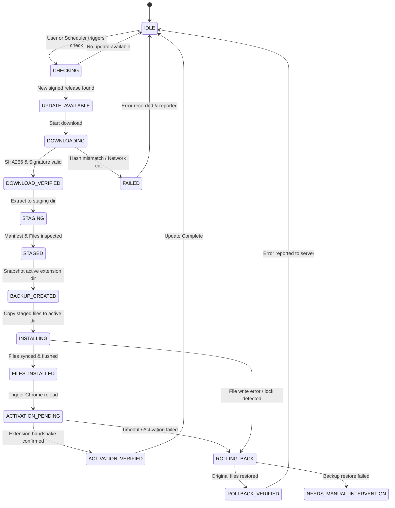

# Architecture Specification: Driver and Update Assistant

## 1. System Overview

The **Driver and Update Assistant** is an enterprise-grade, secure Windows subsystem designed for the **Delivery Assistant** Chrome extension (`Automoby to Chapar & Post - CX Master`). It is built to operate across ~10 Windows laptops connected to a common company Wi-Fi / Local Area Network (LAN).

The subsystem addresses two distinct operational needs:
1. **Feature A — Extension Update Management:** Centralized release distribution, cryptographic validation, transactional installation, and Chrome unpacked extension reload verification.
2. **Feature B — Explicitly Authorized Folder Access:** Consent-based, short-lived, request-bound one-time passcode (OTP) authorized network folder sharing for administrative diagnostics without opening persistent backdoors or weakening system security.

```
       +-------------------------------------------------------------+
       |               DESIGNATED ADMINISTRATOR LAPTOP               |
       |                                                             |
       |  +---------------------+        +------------------------+  |
       |  |    Admin Console    | <----> |      Admin Server      |  |
       |  |   (CLI Publisher &  |        |  (HTTP/REST LAN Svc,   |  |
       |  |  Device Registry)   |        |   Port 8443 / 8088)    |  |
       |  +---------------------+        +------------------------+  |
       +---------------------------------------------^---------------+
                                                     |
                                   Company Wi-Fi/LAN | REST (TLS / Auth Token)
                                                     |
       +---------------------------------------------v---------------+
       |                   EMPLOYEE LAPTOP (1 of 10)                 |
       |                                                             |
       |  +-------------------------------------------------------+  |
       |  |                Google Chrome Browser                  |  |
       |  |  +-------------------------------------------------+  |  |
       |  |  |  Delivery Assistant Extension (MV3, Unpacked)   |  |  |
       |  |  |  - Service Worker (background.js)               |  |  |
       |  |  |  - Content Scripts (ui-render.js, etc.)         |  |  |
       |  |  +---------------------------^---------------------+  |  |
       |  +------------------------------|------------------------+  |
       |                                 | Chrome Native Messaging   |
       |                                 | (Standard In/Out JSON)    |
       |  +------------------------------v------------------------+  |
       |  |          Windows Update & Folder Access Agent         |  |
       |  |                                                       |  |
       |  |  - CLI (Compact 2-Option Menu: Persian / English)     |  |
       |  |  - Transaction State Machine & Journal Engine         |  |
       |  |  - Cryptographic Verifier & Backup / Staging Engine   |  |
       |  |  - Consent-Bound OTP & Temporary Share Lease Engine   |  |
       |  +-------------------------------------------------------+  |
       +-------------------------------------------------------------+
```

---

## 2. Directory & Subsystem Isolation

All source code, configuration templates, tests, documentation, and build artifacts reside strictly inside:
`Delivery Assistant/Driver and update assistant/`

The existing extension root `Delivery Assistant/` receives only the minimal necessary integration touchpoints:
1. `manifest.json`: Adding `"nativeMessaging"` permission.
2. `ui-render.js`: Adding a compact update indicator / trigger button that queries the local native messaging host.
3. No business logic of the extension (Chapar, Post, Jira, table scrapers) is modified or disturbed.

---

## 3. Component Details

### 3.1 Admin Server (`src/driver_update_assistant/server/`)
- **Role:** Binds to the administrator machine's LAN IP. Exposes endpoints for version checks, package downloads, device enrollment, telemetry outbox reports, and folder access request brokering.
- **Security:**
  - Authenticates enrolled devices using per-device shared secrets / bearer tokens.
  - Releases are signed with the administrator private key (HMAC-SHA256 / Ed25519) and verified by agents using the pre-distributed public/verification key.
  - Binds strictly to configured private LAN interfaces (e.g., `192.168.1.x`), never public interfaces.
  - Maintains SQLite database (`data/admin_registry.db`) for device states, release metadata, and security audit logs.

### 3.2 Windows Update Agent (`src/driver_update_assistant/client.py`, `updater/`)
- **Role:** Lightweight Python process running under the logged-in user account.
- **State Machine:** Governs 16 explicit transactional update states.
- **Durable Journaling:** State transitions are written to `data/transaction_journal.json` using atomic file replacement before physical filesystem modifications.
- **Rollback Engine:** Full snapshot of the target extension directory is created before changes. If any verification step fails, files are restored to the exact initial byte state.
- **Zero Arbitrary Execution:** Never executes downloaded binaries, shell scripts, or Python files. Update packages are strictly unpacked as static web assets (JS, CSS, HTML, JSON, images).

### 3.3 Chrome Native Messaging Host (`src/driver_update_assistant/native_messaging/`)
- **Protocol:** Chrome Native Messaging protocol over `stdin`/`stdout` using 32-bit unsigned integer length prefixes.
- **Registration:** Configured in Windows Registry `HKCU\Software\Google\Chrome\NativeMessagingHosts\driver_update_assistant` pointing to `native_host.json`.
- **Allowed Origins:** Strictly limited to `chrome-extension://ajbnjogoeehfjnjbpodgoihmcmooliom/` (the unpacked extension ID) and the production extension ID.
- **Actions Permitted:**
  - `GET_STATUS`: Queries current updater version, pending updates, and folder sharing state.
  - `TRIGGER_UPDATE`: Asks agent to check or apply pending updates.
  - `REPORT_RUNTIME_VERSION`: Extension reports its active in-memory version so the agent can verify activation.
  - `REQUEST_RELOAD`: Extension calls `chrome.runtime.reload()` when new files are staged.
  - Rejects all unknown actions, malformed schemas, and payloads exceeding 64 KB.

### 3.4 Authorized Folder Access Engine (`src/driver_update_assistant/folder_access/`)
- **Consent Mechanism:** The local employee must review the administrator's request (Admin ID, purpose, proposed folder, read/write level, duration).
- **Protected Paths Blocklist:** Rejects system directories (`C:\Windows`, `C:\Program Files`, `C:\Users\<user>\AppData`, root drives, browser directories).
- **OTP Challenge:** Agent generates a cryptographically secure 8-digit OTP via `secrets.randbelow()`. Server stores only an HMAC hash.
- **Lease Model:** Creates a temporary SMB share (`net share`) and narrowly scoped firewall rule. Share has a hard lease (e.g., 15-60 minutes).
- **Cleanup Engine:** On lease expiration, user revocation, or agent restart after a crash/reboot, all temporary shares and firewall rules are unprovisioned and verified.

---

## 4. Update Transaction State Machine

The updater transitions through the following formal states:



---

## 5. Chrome "Load Unpacked" Activation Realities

In Developer Mode ("Load unpacked"):
- Simply replacing files on disk **does not** immediately update the running extension scripts in Chrome's active V8 isolates or Service Worker.
- Chrome must either:
  1. Call `chrome.runtime.reload()` from within the extension service worker or background page.
  2. Have the user click the reload button on `chrome://extensions`.
  3. Restart Google Chrome.
- **Our Implementation:**
  1. Agent replaces files and enters `ACTIVATION_PENDING`.
  2. Native messaging host signals the active extension service worker to execute `chrome.runtime.reload()`.
  3. Upon reload, the new extension script runs, connects to the Native Messaging host, and sends `REPORT_RUNTIME_VERSION` with the new version string.
  4. Only upon receiving this proof does the agent transition to `ACTIVATION_VERIFIED`. If activation is not verified within a configurable timeout (e.g. 60 seconds), the agent warns the user or rolls back.

---

## 6. Network & Interface Binding

- **Admin Server:** Binds to `0.0.0.0` or a specific LAN adapter (e.g. `192.168.1.x`) on port `8088` (HTTP/REST) or `8443` (HTTPS/TLS).
- **Agent Client:** Outbound HTTP/HTTPS requests to Admin Server IP.
- **SMB Share (Folder Access):** Windows SMB port 445. The agent temporarily configures an inbound firewall rule scoped strictly to the Admin IP address and automatically removes it on lease expiry.
