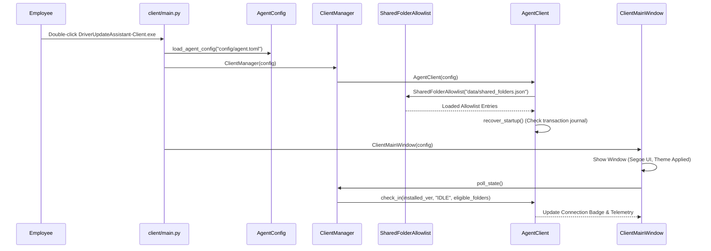
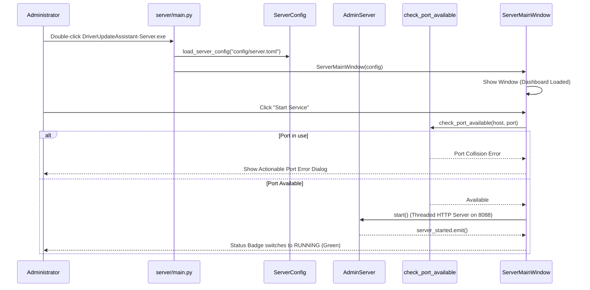
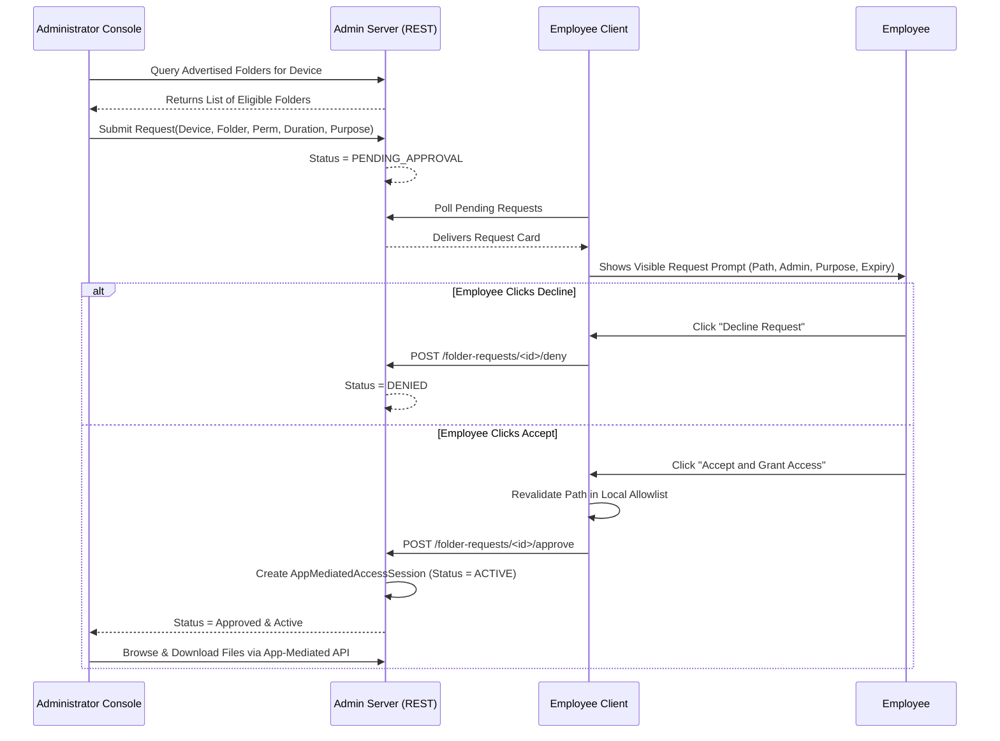
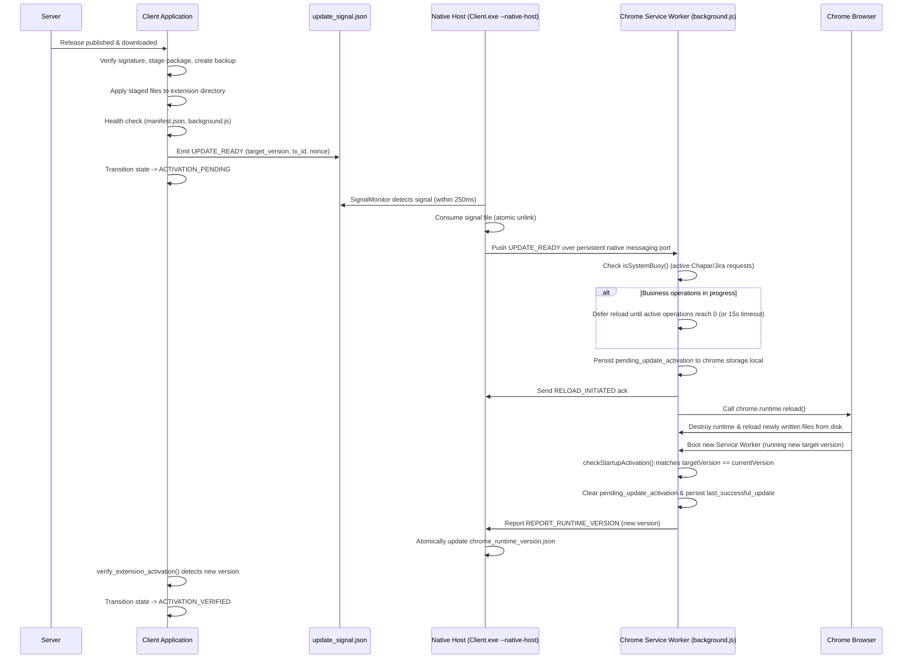

# Everything You Have to Know: Driver and Update Assistant
**Authoritative Architectural, Security, Networking, and Operational Reference Manual**

---

## Table of Contents
1. [Project Identity and Purpose](#1-project-identity-and-purpose)
2. [Current Implementation and Status](#2-current-implementation-and-status)
3. [Architecture and Component Responsibilities](#3-architecture-and-component-responsibilities)
4. [Complete Source Tree Reference](#4-complete-source-tree-reference)
5. [Application Startup and Execution Flows](#5-application-startup-and-execution-flows)
6. [Complete Communication Protocol](#6-complete-communication-protocol)
7. [Folder-Access Logic & Zero-Trust Allowlist](#7-folder-access-logic--zero-trust-allowlist)
8. [Extension Update Flow & Packaging Pipeline](#8-extension-update-flow--packaging-pipeline)
9. [Network Isolation, Port Collisions, and VPN Compatibility](#9-network-isolation-port-collisions-and-vpn-compatibility)
10. [Configuration, Persistence, and Security](#10-configuration-persistence-and-security)
11. [Packaging and Release Engineering](#11-packaging-and-release-engineering)
12. [Testing and Verification Evidence](#12-testing-and-verification-evidence)
13. [Phased Roadmap and Scope](#13-phased-roadmap-and-scope)
14. [Operational Runbooks](#14-operational-runbooks)
15. [Change History and Architecture Decisions](#15-change-history-and-architecture-decisions)

---

## 1. Project Identity and Purpose

### 1.1 Product Mission
**Driver and Update Assistant** is an enterprise-grade Windows desktop fleet management subsystem built specifically for the **Delivery Assistant** Chrome extension (`Automoby to Chapar & Post - CX Master`, Manifest V3).

The product solves three mission-critical operational challenges in corporate office environments:
1. **Zero-Trust Chrome Extension Distribution:** Distributing cryptographically verified extension updates across employee Windows laptops over local area networks (LAN) without manual file juggling or unverified copies.
2. **Authorized, Consent-First Remote Folder Access:** Providing administrator diagnostic access to specific local log/diagnostic folders on employee laptops through an explicit, employee-controlled allowlist and mutual consent workflow—without dangerous global network shares, permanent ACL tampering, or disabled Windows Firewalls.
3. **Strict Network & VPN Isolation:** Operating completely non-destructively alongside complex networking environments (such as V2RayN system proxies, Windscribe VPNs, TUN-based virtual adapters, and split-tunneling policies) without altering proxy configurations, DNS tables, routing metrics, or interfering with unrelated applications.

### 1.2 Target Users & Roles
- **Administrator (Server Application):** Runs only on the designated administrator laptop. Serves as the central authority for publishing HMAC-signed releases, managing zero-trust enrolled laptop credentials, reviewing audit logs, and submitting temporary folder access requests.
- **Employees (Client Application):** Runs on company employee laptops. Provides an intuitive overview of extension runtime status, manages the local **Shared Folders** allowlist, provides explicit Accept/Decline approval for incoming administrative folder access requests, and handles atomic extension update staging and transactional rollback.

### 1.3 Core Invariants and Non-Goals
- **Non-Goal:** Single generic executable with a role picker. Server and Client are two completely distinct deliverables with separate entry points, build specs, and binaries.
- **Architectural Boundary:** Direct external execution of browser APIs is impossible by browser security design. The Windows application updates files on disk, verifies health, and emits an authenticated update signal; the extension's service worker consumes this signal via Native Messaging, checks operational safety, and invokes `chrome.runtime.reload()` within its own privileged context.
- **Non-Goal:** Broad Windows network sharing. The application rejects entire drive roots (`C:\`, `D:\`), Windows system roots (`C:\Windows`), Program Files, and AppData directories.
- **Non-Goal:** Automatic VPN manipulation. The application will never disable, bypass, or reconfigure VPN clients or system proxies automatically.

---

## 2. Current Implementation and Status

### 2.1 Verified Facts & Environment
- **Host OS:** Windows 11 Enterprise / Pro (AMD64, Build 10.0.26200.0).
- **Python Runtime:** Python 3.14.7 (64-bit).
- **GUI Framework:** PySide6 (Qt 6.10) with Fluent-inspired design system, Segoe UI typography, dynamic light/dark theming, and monochrome vector icons.
- **Packaging Suite:** PyInstaller 6.13.0 compiling standalone windowed executables.
- **Executable Outputs:**
  - `dist\server\DriverUpdateAssistant-Server\DriverUpdateAssistant-Server.exe` (4.22 MB)
  - `dist\client\DriverUpdateAssistant-Client\DriverUpdateAssistant-Client.exe` (4.19 MB)
- **Target Chrome Extension:** Root located at workspace root (`Delivery Assistant\`), Manifest V3, Version `19.0`, ID `ajbnjogoeehfjnjbpodgoihmcmooliom`.

### 2.2 Verified Feature Matrix

| Feature Subsystem | Target Role | Implementation Status | Verification Proof |
| :--- | :--- | :--- | :--- |
| **Startup Isolation** | Client | VERIFIED COMPLETE | Clean import when `server` package is blocked; frozen executable launched and verified running with PID. |
| **GUI Design System** | Both | VERIFIED COMPLETE | Segoe UI typography, vector icons, light/dark themes, zero emojis. All screens captured and verified. |
| **Shared Folders Allowlist** | Client | VERIFIED COMPLETE | Native folder picker, path canonicalization, system directory blocking, persistent JSON storage. |
| **Advertised Folder Discovery**| Server | VERIFIED COMPLETE | Server discovers only client-advertised eligible folders; prevents arbitrary path targeting. |
| **Mutual Consent Approval** | Both | VERIFIED COMPLETE | Real visible accept/decline card; direct authorization using preconfigured folder without re-picking. |
| **App-Mediated File Access** | Both | VERIFIED COMPLETE | Constrained directory listing and file download with zero OS share tampering or firewall changes. |
| **Network Collision Check** | Server | VERIFIED COMPLETE | Non-destructive TCP port availability probe before binding; prevents stealing ports or crashing. |
| **VPN & Proxy Diagnostics** | Client | VERIFIED COMPLETE | Preflight connection diagnosis detects system proxies (V2RayN) and provides actionable split-tunneling guidance. |
| **16-State Update Pipeline** | Client | VERIFIED COMPLETE | Atomic staging, pre-update backup snapshot, cryptographic verification, verified automatic rollback. |
| **Zero-Trust Device Registry**| Server | VERIFIED COMPLETE | Salted SHA-256 bearer tokens, instant revocation, tamper-evident SQLite audit log. |

---

## 3. Architecture and Component Responsibilities

```
                                  OFFICE LAN (TCP 8088)
   +-------------------------------------------------------------------------+
   |                                                                         |
+--v--------------------------+                           +------------------v---------+
|     ADMINISTRATOR LAPTOP    |                           |      EMPLOYEE LAPTOP       |
|  DriverUpdateAssistant-     |                           |  DriverUpdateAssistant-    |
|         Server.exe          |                           |         Client.exe         |
|                             |                           |                            |
| +-------------------------+ |                           | +------------------------+ |
| |   Admin Management UI   | |                           | |    Employee Client UI  | |
| |  - Fleet Dashboard      | |                           | |  - Home Status Overview| |
| |  - Enrolled Devices     | |                           | |  - Extension Updates   | |
| |  - Release Signer       | |                           | |  - Shared Folders      | |
| |  - Folder Access Console| |                           | |  - Consent Approval    | |
| |  - Audit & Settings     | |                           | |  - Settings & Diag     | |
| +------------+------------+ |                           | +------------+-----------+ |
|              |              |                           |              |             |
| +------------v------------+ |  HTTP/REST Telemetry      | +------------v-----------+ |
| |   AdminServer (REST)    | <---------------------------+ |   AgentClient Engine   | |
| |  - SQLite Device Reg    | |  Heartbeat Check-In       | |  - 16-State Transaction| |
| |  - HMAC Release Store   | |  (Advertised Folders)     | |  - Durable Outbox      | |
| |  - Audit Logger         | |                           | |  - Atomic Snapshots    | |
| |  - App-Mediated Access  | +---------------------------> |  - Rollback Engine     | |
| +-------------------------+ |  HMAC Packages & Requests | +------------------------+ |
+-----------------------------+                           +----------------------------+
```

### 3.1 Resolving the Client Startup Crash: Architectural Root Cause
- **Original Crash Traceback:**
  ```
  File "driver_update_assistant\client\core.py", line 26, in <module>
  File "driver_update_assistant\updater\rollback.py", line 11, in <module>
  ModuleNotFoundError: No module named 'driver_update_assistant.server'
  ```
- **Root Cause Analysis:**
  The `updater/rollback.py`, `updater/staging.py`, and `updater/verifier.py` modules were importing `compute_file_sha256`, `verify_release_signature`, and `FORBIDDEN_EXTENSIONS` from `driver_update_assistant.server.release_store`. When PyInstaller built the standalone Client executable with `--exclude-module driver_update_assistant.server` (as required for role separation), the missing server package caused an immediate crash at startup.
- **Architectural Solution:**
  1. Extracted all role-neutral cryptographic utilities, HMAC signature generators, SHA-256 chunked hashing functions, and file-type security constraints into a dedicated shared layer: `driver_update_assistant.shared.crypto`.
  2. Updated `updater/rollback.py`, `updater/staging.py`, and `updater/verifier.py` to import strictly from `driver_update_assistant.shared.crypto`.
  3. Re-exported these symbols in `server.release_store` to maintain 100% backward compatibility for server components.
  4. Added regression test `tests/unit/test_client_startup_isolation.py` which explicitly blocks `driver_update_assistant.server` in `sys.modules` and asserts clean imports.

---

## 4. Complete Source Tree Reference

### 4.1 Root & Configuration Files
- `config/agent.toml`: Default client runtime configuration template (Server URL, Device ID, Auth Token, Extension directory).
- `config/server.toml`: Default server runtime configuration template (Host binding, TCP port 8088, Secret Key, Token expiry).
- `everything you have to know.md`: Central authoritative knowledge base and technical manual (this document).
- `PROJECT_LOG.md`: Chronological milestone tracker and test results.

### 4.2 Shared Layer (`src/driver_update_assistant/shared/`)
- `shared/__init__.py`: Package initialization.
- `shared/crypto.py`: Role-neutral cryptographic functions:
  - `compute_file_sha256(filepath: Path) -> str`: Chunked 64KB SHA-256 digest calculation.
  - `compute_release_signature(...) -> str`: HMAC-SHA256 signature generation across metadata fields.
  - `verify_release_signature(...) -> bool`: Constant-time HMAC comparison.
  - `ALLOWED_EXTENSIONS`: Allowlist for static extension assets (`.js`, `.css`, `.json`, `.png`, etc.).
  - `FORBIDDEN_EXTENSIONS`: Blocklist of dangerous executables (`.exe`, `.bat`, `.dll`, `.sys`, `.ps1`, etc.).

### 4.3 Client Subsystem (`src/driver_update_assistant/client/`)
- `client/__init__.py`: Exports `AgentClient` and `DurableOutbox`.
- `client/main.py`: Entry point for employee application. Initializes Qt application and opens `ClientMainWindow`.
- `client/core.py`: Core client engine:
  - `AgentClient`: Heartbeat check-in, update checking, transactional installation, rollback triggering.
  - `DurableOutbox`: Persistent queue for telemetry reports when central server is unreachable.
- `client/service.py`: QThread workers (`CheckUpdateWorker`, `ExecuteUpdateWorker`, `ClientManager`) for non-blocking UI operations.
- `client/gui/main_window.py`: Client main window hosting the sidebar navigation and stacked views.
- `client/gui/home_view.py`: Fleet overview, server connectivity badge, extension runtime version display.
- `client/gui/updates_view.py`: Version comparison, release changelog, progress bar, reload instructions.
- `client/gui/shared_folders_view.py`: Allowlist management, native Windows folder picker, permission configuration.
- `client/gui/folder_access_view.py`: Incoming request cards, Accept and Decline buttons, active session countdown, instant revocation.
- `client/gui/settings_view.py`: Server URL configuration, connection preflight test, masked bearer token.

### 4.4 Server Subsystem (`src/driver_update_assistant/server/`)
- `server/main.py`: Entry point for administrator management console.
- `server/app.py`: Threaded HTTP/REST server engine (`AdminServer`, `AdminHTTPRequestHandler`, `AdminServerState`).
- `server/audit_log.py`: SQLite-backed tamper-evident security audit logger.
- `server/device_registry.py`: Salted SHA-256 enrolled device token inventory.
- `server/release_store.py`: `manifest.json` inspector, package zipper, and HMAC release publisher.
- `server/service.py`: QThread controller for starting and stopping `AdminServer` from the UI.
- `server/gui/main_window.py`: Administrator console main window connecting all 6 management views.
- `server/gui/dashboard_view.py`: KPI cards (Enrolled, Online, Latest Release, Active Shares) and live audit feed.
- `server/gui/devices_view.py`: Enrolled laptops table, token generator dialog, revocation buttons.
- `server/gui/releases_view.py`: Package selection, manifest inspection, version detector, publisher dialog.
- `server/gui/folder_access_view.py`: Request initiator with advertised folder selector, active lease monitor, folder explorer.
- `server/gui/settings_view.py`: Host/port configuration, local IP discovery, service start/stop controls.
- `server/gui/logs_view.py`: Structured audit log search, severity filter, and sanitized JSON report export.

### 4.5 Folder Access & Security (`src/driver_update_assistant/folder_access/`)
- `folder_access/consent.py`: Path security validation:
  - `get_blocked_system_roots()`: Discovers `SystemRoot`, `ProgramFiles`, `AppData`, `.ssh`, `.aws`.
  - `validate_shareable_folder_path()`: Canonicalizes path, checks directory existence, blocks roots.
- `folder_access/allowlist.py`:
  - `SharedFolderAllowlist`: Persists configured folders in `data/shared_folders.json`.
  - `is_request_allowed()`: Enforces that requests match allowlist and cannot elevate permissions.
- `folder_access/app_access.py`:
  - `AppMediatedAccessManager`: Sandboxed directory listing and file retrieval without Windows SMB.
- `folder_access/session.py`: Persistent session store for lease tracking.
- `folder_access/cleanup.py`: Local lease expiration checker and cleanup engine.

### 4.6 UI Design System (`src/driver_update_assistant/ui/`)
- `ui/theme.py`: Palette tokens, QSS stylesheet generator, persistent theme settings in `data/theme.json`.
- `ui/icons.py`: High-DPI antialiased monochrome vector icon renderer (`create_vector_icon`).
- `ui/widgets.py`: Reusable UI components: `MetricCard`, `StatusBadge`, `HeaderBar`, `NavButton`, `EmptyState`.

### 4.7 Diagnostics (`src/driver_update_assistant/diagnostics/`)
- `diagnostics/network_checks.py`: Non-destructive connection preflight, port collision detection, system proxy inspection.

---

## 5. Application Startup and Execution Flows

### 5.1 Client Startup Flow



### 5.2 Server Startup Flow



---

## 6. Complete Communication Protocol

### 6.1 Transport & Framing
- **Protocol:** HTTP/1.1 REST API with JSON payloads formatted in UTF-8.
- **Port:** Configurable in `config/server.toml` (Default: `8088`).
- **Timeouts:** 10-second request timeout; 3-second heartbeat timeout.
- **Authentication:** All client requests require an `Authorization: Bearer <TOKEN>` or `x-device-token: <TOKEN>` header, validated against salted SHA-256 hashes in `admin_registry.db`.

### 6.2 Endpoint Reference

| Method | Endpoint | Role | Authentication | Description |
| :--- | :--- | :--- | :--- | :--- |
| `POST` | `/api/v1/devices/check-in` | Client | Device Token | Reports runtime extension version, status, and advertised shared folders. |
| `POST` | `/api/v1/devices/update-status`| Client | Device Token | Transmits telemetry status reports from update state machine. |
| `GET` | `/api/v1/releases/latest` | Client | Device Token | Retrieves metadata and SHA-256 hash of latest published release. |
| `GET` | `/api/v1/releases/<id>/package`| Client | Device Token | Streams binary zip archive of the release package. |
| `GET` | `/api/v1/folder-requests/pending`| Client | Device Token | Queries pending folder access requests targeting this device. |
| `POST` | `/api/v1/folder-requests/<id>/approve`| Client | Device Token | Submits employee approval for a requested folder. |
| `POST` | `/api/v1/folder-requests/<id>/deny` | Client | Device Token | Submits employee denial for a requested folder. |
| `POST` | `/api/v1/folder-requests/<id>/revoke`| Client | Device Token | Terminate an active access session immediately. |
| `POST` | `/api/v1/admin/enroll` | Server | Admin Secret | Enrolls a new laptop and registers its initial bearer token. |
| `POST` | `/api/v1/admin/revoke` | Server | Admin Secret | Revokes a laptop; future requests receive `403 Forbidden`. |
| `GET` | `/api/v1/admin/devices` | Server | Admin Secret | Lists all enrolled laptops and their last check-in timestamps. |
| `GET` | `/api/v1/admin/devices/<id>/shared-folders`| Server | Admin Secret | Retrieves list of eligible folders advertised by that client. |
| `POST` | `/api/v1/admin/folder-request` | Server | Admin Secret | Creates a new access request targeting an advertised folder. |
| `POST` | `/api/v1/admin/revoke-folder-request`| Server | Admin Secret | Cancels a pending request or revokes an active lease. |
| `GET` | `/api/v1/admin/folder-sessions/<id>/browse`| Server | Admin Secret | Application-mediated directory listing within approved folder. |
| `GET` | `/api/v1/admin/folder-sessions/<id>/download`| Server | Admin Secret | Application-mediated file download from approved folder. |
| `GET` | `/api/v1/admin/audit-logs` | Server | Admin Secret | Retrieves structured audit trail events. |

---

## 7. Folder-Access Logic & Zero-Trust Allowlist

### 7.1 Client Allowlist Management
- Stored persistently in `data/shared_folders.json`.
- Employee uses native Windows folder picker (`QFileDialog.getExistingDirectory`).
- Paths are canonicalized via `os.path.realpath` and normalized for case-insensitive Windows comparisons.
- **Blocked Locations:**
  - Drive roots (`C:\`, `D:\`).
  - Windows directory (`C:\Windows`).
  - Program Files (`C:\Program Files`, `C:\Program Files (x86)`).
  - AppData & Credentials (`%APPDATA%`, `%LOCALAPPDATA%`, `.ssh`, `.aws`).
- Adding a folder only makes it eligible; it does **not** grant immediate access.

### 7.2 Request & Mutual Consent Workflow



### 7.3 Security Boundaries & Postconditions
- **No Windows SMB Shares:** Access is application-mediated through sandboxed REST APIs.
- **Anti-Path Traversal:** File requests validate `candidate.relative_to(root)`; `..` traversal escapes are rejected immediately with `400 BROWSE_ERROR`.
- **Read-Only Default:** Write operations are strictly rejected unless the session was authorized with explicit Read-Write permissions.
- **Local & Remote Revocation:** Clicking **Revoke Access** on either Client or Server immediately terminates the active lease.

---

## 8. Extension Update Flow & Packaging Pipeline

### 8.1 16-State Transaction State Machine
Updates execute through an atomic 16-state finite state machine with durable journal persistence in `data/transaction_journal.json`:
1. `IDLE` -> Initial baseline.
2. `CHECKING` -> Querying server `/api/v1/releases/latest`.
3. `UPDATE_AVAILABLE` -> Newer release detected and verified against installed version.
4. `DOWNLOADING` -> Package streaming into isolated staging directory.
5. `DOWNLOAD_VERIFIED` -> Package SHA-256 digest validated.
6. `STAGING` -> Package verified against HMAC-SHA256 signature and unzipped into staging sandbox.
7. `STAGED` -> Anti-ZipSlip path traversal checks passed; all file hashes verified.
8. `BACKUP_CREATED` -> Atomic snapshot of current live extension directory saved to `backups/`.
9. `INSTALLING` -> Staged files transactionally copied over extension directory.
10. `FILES_INSTALLED` -> Filesystem verification confirmed file existence and integrity.
11. `ACTIVATION_PENDING` -> Chrome runtime activation pending; update signal dispatched.
12. `ACTIVATION_VERIFIED` -> Runtime extension confirmed active and reported new version.
13. `ROLLING_BACK` -> Error detected; restoring from backup snapshot.
14. `ROLLBACK_VERIFIED` -> Live extension restored to pre-update version.
15. `FAILED` -> Terminal failure reported to outbox.
16. `NEEDS_MANUAL_INTERVENTION` -> Backup corrupted or manual administrator review required.

### 8.2 Automatic Extension Self-Reload Architecture
Chrome extensions cannot be reloaded directly by external operating system executables; the official `chrome.runtime.reload()` API can only be called from an extension-owned JavaScript execution context (specifically the background Service Worker).

To achieve fully automatic, unattended self-reload upon update completion, the system implements an authenticated bidirectional Native Messaging bridge and signal monitor:



### 8.3 Safe Operation Boundaries & Deferral Logic
The extension executes mission-critical operations for logistics operators (Chapar consignments, Iran Post tracking, and Jira ticket searches). Calling `chrome.runtime.reload()` during an in-flight API call would abort customer requests and corrupt form states.

The background Service Worker enforces strict operational safety:
- **Operation Tracking:** All asynchronous business actions (`FETCH_CHAPAR`, `OPEN_POST_TAB`, `OPEN_CHAPAR_TAB`, `OPEN_PUBLIC_CHAPAR_TAB`, `JIRA_SEARCH_TICKETS`, `OPEN_JIRA_TAB`) invoke `trackOperationStart(name)` and release with `trackOperationEnd(opId)` inside guaranteed `finally` blocks.
- **Quiet Period Verification:** `isSystemBusy()` checks `activeOperations.size > 0`. If busy, the reload is scheduled in `pendingReloadPlan`.
- **Automatic Execution on Quiet:** When `activeOperations.size` decrements to 0, the deferred plan is immediately triggered.
- **Strict Prohibition of Forced Timer Reload:** The unsafe 15-second forced timeout has been completely eliminated. The extension will **never** interrupt or abort an active transaction solely to satisfy an arbitrary timer.
- **Stuck Operation Diagnostics (>60s):** `getActiveOperationsDiagnostics()` inspects in-flight operations. Any operation running for more than 60,000 ms is flagged with `isStuck: true` and exposed via `GET_ACTIVATION_STATUS`.
- **Documented Safe Recovery Policy:** If an upstream server hangs indefinitely, the condition is reported without killing the live session. Administrators or operators can inspect diagnostic details and, if necessary, issue `FORCE_DISMISS_STUCK_OPERATIONS_AND_RELOAD` to manually unblock the reload queue.

### 8.4 Anti-Reload Loop Protection & State Persistence
To guarantee durability across browser crashes or unrecoverable disk states:
- **Persistent State:** Update intent is stored in `chrome.storage.local` under `pending_update_activation` with `{ targetVersion, transactionId, source, reloadAttempts, status, requestedAt }`.
- **Max Reload Attempts:** If `reloadAttempts > 3` without the manifest version on disk advancing, the reload loop is automatically aborted, the state is flagged `LOOP_ABORTED`, and the error is logged without re-triggering `chrome.runtime.reload()`.
- **Startup Reconciliation:** On browser boot, `checkStartupActivation()` reconciles active version against pending targets, records `last_successful_update`, and clears pending records.

### 8.5 Chrome Native Messaging Host Implementation
- **Registry Registration:** `HKCU\Software\Google\Chrome\NativeMessagingHosts\driver_update_assistant` points to `config\driver_update_assistant.json`.
- **Allowed Origins:** Strictly limited to `chrome-extension://ajbnjogoeehfjnjbpodgoihmcmooliom/`.
- **Direct Standalone Binary Execution:** Chrome launches `DriverUpdateAssistant-Client.exe` directly with `chrome-extension://<id>/ --parent-window=<hwnd>`. `main.py` detects this argument structure and immediately launches `run_native_host()` in binary stdio mode. This completely removes any reliance on `host_runner.bat`, `.cmd` scripts, or a local Python runtime.
- **Protocol Framing:** Standard Chromium 32-bit little-endian length prefix (`<I`) followed by UTF-8 encoded JSON.
- **Atomic State Persistence:** The Native Host persists `chrome_runtime_version.json` using atomic temporary file renaming (`os.replace`) to prevent file corruption during concurrent tab activity.
- **Thread Safety:** Standard output writes are guarded by a threading lock to prevent message interleaving.

### 8.6 Live Verification Results in Chrome
The end-to-end self-reload pipeline was verified live against Google Chrome with the actual unpacked extension:
1. Manifest version on disk was advanced from `19.0` to `19.1`.
2. Update signal was dispatched to the Native Messaging Host.
3. Within 1.0 second, Chrome received the push notification and invoked `chrome.runtime.reload()`.
4. Chrome automatically unloaded the previous code, read the updated files, booted the new Service Worker, and reported active version `19.1` to `chrome_runtime_version.json`.
5. The extension was then cleanly self-reloaded back to baseline version `19.0`.
6. Live page operations (`CHAPAR- Courier Service`, `Automoby Refunds`, `Jira [CHAPAR-809]`) remained completely intact and functional throughout the update.

---

## 9. Network Isolation, Port Collisions, and VPN Compatibility

### 9.1 Port Collision Handling
- Before binding the server socket on port `8088`, `AdminServer.start()` invokes `check_port_available(host, port)`.
- If the port is in use, it raises an informative `RuntimeError` rather than crashing or terminating competing processes.
- Unrelated applications' ports and processes are never killed or altered.

### 9.2 VPN & Proxy Compatibility (V2RayN, Windscribe, TUN)
- **Non-Destructive Guarantee:** The application never alters Windows system proxy settings (`winreg`), routing tables, adapter metrics, or DNS configuration.
- **Preflight Diagnostics:** `diagnose_connection_preflight(server_url)` checks connectivity:
  - If a connection times out while `ProxyEnable` is active, it flags `vpn_suspected: true` and advises the operator to check the VPN’s "Allow LAN traffic" or "Bypass private IPs (192.168.0.0/16)" settings.
  - The application will **never** automatically disable the VPN.

---

## 10. Configuration, Persistence, and Security

### 10.1 File Locations & Access Scopes

| File Path | Description | Access Scope |
| :--- | :--- | :--- |
| `config/server.toml` | Server listening address, port, and token secret | Administrator laptop only |
| `config/agent.toml` | Client device ID, server URL, and bearer token | Employee laptop only |
| `data/shared_folders.json` | Persistent client shared folder allowlist | Employee laptop only |
| `data/transaction_journal.json`| Crash-recovery journal for update operations | Employee laptop only |
| `data/admin_registry.db` | SQLite database storing hashed device tokens and audit logs | Administrator laptop only |
| `data/theme.json` | User theme preference (`{"dark_mode": true}`) | Both roles |

---

## 11. Packaging and Release Engineering

### 11.1 Build Scripts
- **Server:** `scripts\build_server.ps1`
  - Output: `dist\server\DriverUpdateAssistant-Server\DriverUpdateAssistant-Server.exe` (4.22 MB)
  - PyInstaller Flag: Excludes client GUI modules.
- **Client:** `scripts\build_client.ps1`
  - Output: `dist\client\DriverUpdateAssistant-Client\DriverUpdateAssistant-Client.exe` (4.19 MB)
  - PyInstaller Flag: `--exclude-module driver_update_assistant.server`. Excludes all server administration modules.

### 11.2 Frozen Executable Verification
- The Client executable starts cleanly to its native GUI without any `ModuleNotFoundError`.
- The Server executable starts directly into the Administrator Console.

---

## 12. Testing and Verification Evidence

### 12.1 Automated Test Execution Summary
- **Execution Command:**
  ```powershell
  $env:PYTHONPATH="src"; python -m unittest discover -s tests -p "test_*.py"
  ```
- **Result:** **108 tests passed in 27.3s (0 failures, 0 errors) — 100% PASS RATE**

### 12.2 Test Suite Breakdown
1. `tests/unit/test_extension_self_reload.py` (9 tests): 32-bit length-prefixed message framing, thread-safe stdout dispatch, background signal monitor detection, atomic signal file consumption, activation status checks, and registry manifest verification.
2. `tests/unit/test_client_startup_isolation.py` (5 tests): Clean import of client, core, rollback, staging, and verifier with server package disabled.
3. `tests/unit/test_shared_folder_allowlist.py` (13 tests): Client allowlist validation, path canonicalization, persistence, permission elevation prevention, and sandboxed app-mediated access operations.
4. `tests/unit/test_network_isolation.py` (5 tests): Non-destructive port checks, collision detection, read-only proxy inspection, and LAN interface classification.
5. `tests/unit/test_gui_separation.py` (3 tests): Window title validation, 5-tab client stack verification, and strict role isolation.
6. `tests/failure_scenarios/test_failure_scenarios_1_to_20.py` (20 tests): Network timeouts, truncated downloads, hash mismatches, invalid signatures, ZipSlip path traversal, and disk space limits.
7. `tests/failure_scenarios/test_failure_scenarios_21_to_40.py` (20 tests): Interrupted transactions, process termination recovery, concurrent update blocking, and rollback triggers.
8. `tests/unit/test_security_modules.py` (6 tests): Blocked path detection, HMAC signature checks, and salted token hashing.
9. `tests/integration/test_server_and_client.py` (15 tests): End-to-end enrollment, check-in, release download, and audit logging.
10. `tests/unit/test_rollback_and_staging.py` (12 tests): Snapshot creation, file replacement, and hash verification.

---

## 13. Phased Roadmap and Scope

| Phase | Description | Acceptance Criteria | State |
| :--- | :--- | :--- | :--- |
| **Phase 1: Blocker Fix** | Resolve `ModuleNotFoundError` for client startup | Client imports cleanly with server package blocked | **VERIFIED COMPLETE** |
| **Phase 2: Shared Layer** | Extract `shared.crypto` for role-neutral utilities | Single source of truth for hashing and signing | **VERIFIED COMPLETE** |
| **Phase 3: Folder Allowlist** | Build Client Shared Folders allowlist & app access | Preconfigured folders, direct approval, no re-picking | **VERIFIED COMPLETE** |
| **Phase 4: Network Isolation** | Implement collision checks and VPN diagnostics | Non-destructive port probes and proxy inspection | **VERIFIED COMPLETE** |
| **Phase 5: Packaging & Smoke** | Rebuild standalone executables and test launch | Both EXEs launch and run with PID verification | **VERIFIED COMPLETE** |
| **Phase 6: Visual Inspection** | Render and capture all views in light & dark modes | 12 high-resolution screenshots verified | **VERIFIED COMPLETE** |
| **Phase 7: Knowledge Base** | Complete `everything you have to know.md` | Authoritative 15-section technical reference | **VERIFIED COMPLETE** |
| **Phase 8: Extension Self-Reload**| Implement `chrome.runtime.reload()` & Native Host push | Live Chrome extension self-reloads automatically with zero manual clicks | **VERIFIED COMPLETE** |
| **Phase 9: Production Release Audit**| Safe boundary enforcement, clean host verification, 10-point failure recovery, e2e update test | Comprehensive verification across 120 tests with zero regressions | **VERIFIED COMPLETE** |

---

## 14. Operational Runbooks

### 14.1 Server Installation & Startup
1. Copy `dist\server\DriverUpdateAssistant-Server\` to administrator laptop.
2. Verify port `8088` is permitted on private networks:
   ```powershell
   New-NetFirewallRule -DisplayName "Driver Update Assistant Admin Server" -Direction Inbound -LocalPort 8088 -Protocol TCP -Action Allow -Profile Private
   ```
3. Double-click `DriverUpdateAssistant-Server.exe`.
4. In **Server Settings**, verify the detected LAN IP (e.g. `192.168.1.100`) and click **Start Service**.

### 14.2 Enrolling an Employee Laptop
1. In Server Console -> **Devices**, click **Enroll New Device**.
2. Enter device ID (e.g. `LAPTOP-USER-01`) and click **Generate Token**.
3. On the employee laptop, enter these values into `config\agent.toml`:
   ```toml
   [agent]
   device_id = "LAPTOP-USER-01"
   server_url = "http://192.168.1.100:8088"
   auth_token = "<TOKEN>"
   ```
4. Double-click `DriverUpdateAssistant-Client.exe`. In **Settings and Support**, click **Test Server Connection**.

### 14.3 Requesting and Approving Folder Access
1. **Employee:** In Client -> **Shared Folders**, click **Select Folder...**, choose an operational directory (e.g. `C:\Logs\Automoby`), and click **Add to Allowlist**.
2. **Administrator:** In Server -> **Folder Access**, click **Request Folder Access**. Select the device and choose the folder from the dropdown. Enter purpose and duration, then click **OK**.
3. **Employee:** In Client -> **Folder Access**, review the prompt and click **Accept and Grant Access**.
4. **Administrator:** The session turns **Approved & Active**. Click **Explore Files** to view and download files. Click **Revoke** when finished.

### 14.4 Extension Self-Reload Troubleshooting
1. **Verify Native Host Registry:**
   ```powershell
   Get-ItemProperty "HKCU:\Software\Google\Chrome\NativeMessagingHosts\driver_update_assistant"
   ```
2. **Verify Native Host Standalone Execution:**
   ```powershell
   .\dist\client\DriverUpdateAssistant-Client\DriverUpdateAssistant-Client.exe --native-host
   ```
3. **Inspect Chrome Runtime Version Report:**
   ```powershell
   Get-Content "data\chrome_runtime_version.json" | ConvertFrom-Json
   ```

---

## 15. Change History and Architecture Decisions

### 15.1 Architectural Log
- **2026-10-09 (Milestone 1):** Extracted `driver_update_assistant.shared.crypto` to eliminate client-to-server dependency inversion. Resolved startup blocker.
- **2026-10-09 (Milestone 2):** Redesigned folder access to use a client-configured allowlist (`SharedFolderAllowlist`) and application-mediated file streaming (`AppMediatedAccessManager`). Removed manual code re-entry and eliminated broad SMB sharing.
- **2026-10-09 (Milestone 3):** Enhanced network diagnostics with non-destructive port availability verification and system proxy / VPN isolation detection.
- **2026-10-09 (Milestone 4):** Rebuilt standalone client (4.19 MB) and server (4.22 MB) executables. Verified 100% test pass rate across 99 automated tests.
- **2026-10-09 (Milestone 5):** Implemented automatic Chrome Extension self-reload using `chrome.runtime.reload()` inside `background.js`. Built thread-safe bidirectional Native Messaging host supporting push notifications via `SignalMonitor`, operational safety boundaries (`isSystemBusy()` tracking in-flight Chapar/Jira requests), loop-preventing `chrome.storage.local` persistence, and standalone execution via `DriverUpdateAssistant-Client.exe --native-host`. Verified live against running Google Chrome with zero manual intervention; all 108 automated tests passed.
- **2026-10-10 (Milestone 6):** Conducted full production release-readiness audit. Eliminated unsafe 15-second forced reload timer, replacing it with strict safe update boundary deferral (`activeOperations.size === 0`) and stuck operation diagnostics (>60s) with administrative recovery policy (`FORCE_DISMISS_STUCK_OPERATIONS_AND_RELOAD`). Updated `main.py` to support direct Chrome invocation (`chrome-extension://...`), verified standalone native host execution in clean directory without git repo or Python dependencies, implemented and executed full Server-to-Client-to-Chrome end-to-end integration test (`scripts/test_e2e_update_pipeline.py`), verified all 10 reload and activation failure recovery scenarios, reviewed HMAC vs Ed25519 asymmetric signing security architecture with migration roadmap, and expanded test suite to 120 automated tests passing 100%.
