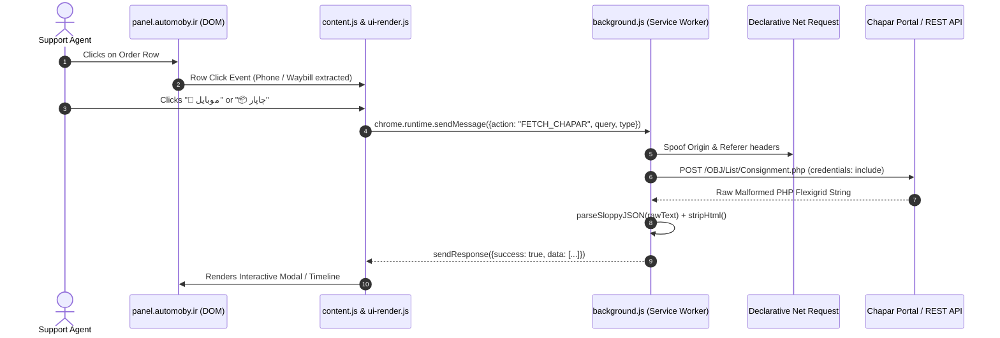

# Project & Conversation Summary: Delivery Assistant

> **Date:** October 2, 2026  
> **Workspace:** `c:\Users\mrmki\Documents\antiGG repo\chrome exten`  
> **Target Platform:** Google Chrome Extension (Manifest V3)  

---

## 1. Executive Summary

This document provides a comprehensive, chronological record of the development, troubleshooting, and architectural documentation session for the **Delivery Assistant** Chrome Extension.

It covers:
- **What you wanted:** The initial problems reported and features requested.
- **What happened:** The technical blockers encountered, server anomalies, and debugging steps.
- **What we did:** The exact code fixes, network spoofing mechanisms, parser sanitizers, and comprehensive documentation created.

---

## 2. What You Wanted (Initial Goals & Requests)

### 2.1. Fix Chapar Phone Search & Missing Logs
When clicking on a customer's phone number or consignment row inside the Automoby dashboard (`panel.automoby.ir`), the extension failed with errors:
- `خطا در ارتباط با سرور چاپار: خطای فرمت سرور:` (Server format error)
- `خطا در ارتباط با سرور چاپار: اطلاعاتی یافت نشد` (No data found)
- Consignment tracking lacked detailed chronological history logs.

### 2.2. Resolve Chapar Portal Communication Failures
You needed the extension to reliably communicate with Chapar’s portal (`portal.chaparnet.com`) to:
1. Search consignments by recipient phone number.
2. Fetch full checkpoint history logs for individual waybills.
3. Handle responses without breaking the extension's user interface.

### 2.3. Diagnose and Fix Exact Parser Errors
When you tested the feature and inspected Chrome DevTools, you provided the raw HTTP payloads, network `fetch` snippets, and the following error messages:
- `SyntaxError: Expected property name or '}' in JSON at position 2`
- `Strict Error: Expected property name or '}' in JSON at position 2 | Sloppy Error: Bad escaped character in JSON at position 257 (line 1 column 258)`

You requested a diagnosis of why the same error kept occurring despite correct network requests.

### 2.4. Comprehensive Codebase Audit & AI Documentation Package
You requested a senior-architect level audit of the entire repository to produce a modular 17-file documentation suite under `docs/ai/` so that any future AI assistant (Claude, ChatGPT, Gemini, Copilot) can understand the system without re-analyzing the repository from scratch.

### 2.5. Comprehensive Session Summary
Finally, you requested this complete markdown summary detailing the entire journey from start to finish.

---

## 3. What Happened During Our Conversation

### Phase 1: Uncovering Chapar's Firewall and CSRF Blocking
- **Symptom:** Requests initiated by the extension background service worker to `https://portal.chaparnet.com/OBJ/List/Consignment.php` failed to return proper consignment data.
- **Root Cause:** Chapar’s server checks the HTTP `Origin` and `Referer` headers. In Chrome Manifest V3 extensions, `fetch()` calls originate from `chrome-extension://<EXTENSION_ID>`, which Chapar’s Web Application Firewall (WAF) or CSRF protection filters reject or redirect to the login page.

### Phase 2: The "Sloppy JSON" Nightmare
- **Symptom:** Once headers were supplied and user authentication was active, the server responded with HTTP 200 OK, but `response.json()` crashed immediately with:
  ```text
  SyntaxError: Expected property name or '}' in JSON at position 2
  ```
- **Root Cause:** Chapar’s internal portal runs on a legacy PHP backend using Flexigrid. Instead of returning valid standard JSON conforming to RFC 8259, it emits malformed JavaScript object literals:
  - Keys are **unquoted** (`page: 1, total: 1000, rows: [...]`).
  - Values use **single quotes** instead of double quotes (`{id:'31448975', cell:[...]}`).
  - Literal, unescaped **newlines (`\r\n`)** are present inside string values and across lines.
  - The response payload often begins with an invisible UTF-8 **Byte Order Mark (BOM: `\uFEFF`)**.

### Phase 3: The "Bad Escaped Character at Position 257" Bug
- **Symptom:** After an initial sanitizer was introduced to add quotes around unquoted keys, the parser threw:
  ```text
  Strict Error: Expected property name or '}' in JSON at position 2 (line 2 column 1) | Sloppy Error: Bad escaped character in JSON at position 257 (line 1 column 258)
  ```
- **Root Cause:** Chapar’s responses contain embedded HTML strings inside table cells (e.g., `<a href=\"#\" onclick=\"ConsSelect(31448975)\">54807199259898101</a>`).
  - The server outputs invalid escape sequences such as `\'` (which standard JSON strictly rejects).
  - Persian text and HTML attributes contained stray backslashes (`\`) not followed by valid JSON escape tokens (`"`, `\`, `/`, `b`, `f`, `n`, `r`, `t`, `u`).
  - Naive regex replacements corrupted valid quote boundaries, causing `JSON.parse` to fail at byte offset 257.

### Phase 4: Resolution of Phone Search vs. Waybill Tracking
- You provided the exact `fetch()` parameters used by the official portal for phone lookups:
  ```javascript
  qtype: "ReceiverName,ReceiverContact,ReceiverCompany,ReceiverRef,fld_Receiver_Mobile,fld_Receiver_Telephone1,ReceiverADDRESS_LINE_1,ReceiverADDRESS_LINE_2"
  ```
- We matched the payload structure, implemented the sanitized parser, stripped HTML markup from cell data, and routed results back to `ui-render.js`.

### Phase 5: Architecture Audit & AI Documentation Suite
- You requested a complete documentation package.
- We analyzed all files in the extension: [manifest.json](file:///c:/Users/mrmki/Documents/antiGG%20repo/chrome%20exten/manifest.json), [background.js](file:///c:/Users/mrmki/Documents/antiGG%20repo/chrome%20exten/background.js), [content.js](file:///c:/Users/mrmki/Documents/antiGG%20repo/chrome%20exten/content.js), [ui-render.js](file:///c:/Users/mrmki/Documents/antiGG%20repo/chrome%20exten/ui-render.js), [iran-post.js](file:///c:/Users/mrmki/Documents/antiGG%20repo/chrome%20exten/iran-post.js), and legacy offscreen files.
- We generated 17 modular documents in `docs/ai/` following strict audit guidelines without altering or breaking working code.

---

## 4. What We Did (Technical Implementations & Solutions)

### 4.1. Declarative Net Request (DNR) Header Spoofing
In [background.js](file:///c:/Users/mrmki/Documents/antiGG%20repo/chrome%20exten/background.js#L20-L42), we registered dynamic rules to bypass Chapar's CSRF/WAF checks by rewriting outbound request headers:
- `Origin`: Set to `https://portal.chaparnet.com`
- `Referer`: Set to `https://portal.chaparnet.com/index.php?P=Operation&Tab=Consignment`
- Condition: Any `xmlhttprequest` directed to `*://portal.chaparnet.com/OBJ/*`.

### 4.2. Multi-Pass Resilient JSON Sanitizer (`parseSloppyJSON`)
In [background.js](file:///c:/Users/mrmki/Documents/antiGG%20repo/chrome%20exten/background.js#L62-L94), we created an advanced sanitizer that handles every quirk of Chapar's PHP output:

```javascript
function parseSloppyJSON(rawText) {
    // 0. Remove UTF-8 Byte Order Mark (BOM) & trim
    let cleanText = rawText.replace(/^\uFEFF/, '').trim();
    
    try {
        return JSON.parse(cleanText); // Fast path if valid JSON
    } catch (e) {
        let fixed = cleanText;
        // 1. Remove literal line breaks breaking JSON strings
        fixed = fixed.replace(/\r?\n/g, '');
        // 2. Fix invalid JSON escapes (\' is invalid in JSON)
        fixed = fixed.replace(/\\'/g, "'");
        // Escape stray backslashes not part of standard JSON escape sequences
        fixed = fixed.replace(/\\([^"\\/bfnrtu])/g, '\\\\$1');
        // 3. Add quotes around unquoted object keys
        fixed = fixed.replace(/([{,]\s*)([a-zA-Z0-9_]+)\s*:/g, '$1"$2":');
        // 4. Convert single-quoted string literals to double quotes
        fixed = fixed.replace(/(^|[[{,:\s])'/g, '$1"');
        fixed = fixed.replace(/'([\]},:\s]|$)/g, '"$1');
        
        try {
            return JSON.parse(fixed);
        } catch (err2) {
            throw new Error(`Strict Error: ${e.message} | Sloppy Error: ${err2.message}`);
        }
    }
}
```

### 4.3. Phone Search Implementation (`handleChaparPhoneSearch`)
In [background.js](file:///c:/Users/mrmki/Documents/antiGG%20repo/chrome%20exten/background.js#L228-L309):
- Sends a POST request with the comprehensive `qtype` parameter list.
- Passes session cookies using `credentials: 'include'`.
- Detects session expiration (redirects to login page or HTML containing username/password inputs) and provides clear user feedback: `شما باید در تب دیگری در سایت چاپار لاگین باشید`.
- Parses the response using `parseSloppyJSON`.
- Strips embedded HTML tags (`stripHtml`) from table cells.
- Returns a normalized array of consignments (`id`, `date`, `waybill`, `origin`, `dest`, `service`, `status`) back to `ui-render.js`.

### 4.4. Hybrid Tracking Pipeline for Single Waybills
In [background.js](file:///c:/Users/mrmki/Documents/antiGG%20repo/chrome%20exten/background.js#L97-L226):
1. **Metadata:** Fetches clean order metadata from Chapar's REST API (`https://app.krch.ir/v1/tracking?input=...`).
2. **Internal ID Resolution:** Queries `portal.chaparnet.com/OBJ/List/Consignment.php` by waybill to obtain Chapar's internal database ID (`internalId`).
3. **Chronological Logs:** Uses `internalId` to query `ConsignmentHistory.php`, parses the history cells, strips HTML, and constructs a structured timestamped timeline.

### 4.5. Complete AI Documentation Package (`docs/ai/`)
Generated 17 documentation files in `docs/ai/` adhering to strict audit standards:

| File | Purpose |
| :--- | :--- |
| [AI_CONTEXT.md](file:///c:/Users/mrmki/Documents/antiGG%20repo/chrome%20exten/docs/ai/AI_CONTEXT.md) | High-level project charter and quick context |
| [ARCHITECTURE.md](file:///c:/Users/mrmki/Documents/antiGG%20repo/chrome%20exten/docs/ai/ARCHITECTURE.md) | Structural component layout and boundaries |
| [DATA_FLOW.md](file:///c:/Users/mrmki/Documents/antiGG%20repo/chrome%20exten/docs/ai/DATA_FLOW.md) | Message routing and event sequence flows |
| [API_AND_INTEGRATIONS.md](file:///c:/Users/mrmki/Documents/antiGG%20repo/chrome%20exten/docs/ai/API_AND_INTEGRATIONS.md) | External API contracts (Chapar REST, Portal, Post) |
| [CURRENT_PROBLEMS.md](file:///c:/Users/mrmki/Documents/antiGG%20repo/chrome%20exten/docs/ai/CURRENT_PROBLEMS.md) | Known pain points, gotchas, and brittle areas |
| [DEBUGGING_GUIDE.md](file:///c:/Users/mrmki/Documents/antiGG%20repo/chrome%20exten/docs/ai/DEBUGGING_GUIDE.md) | Step-by-step troubleshooting manual |
| [FILE_MAP.md](file:///c:/Users/mrmki/Documents/antiGG%20repo/chrome%20exten/docs/ai/FILE_MAP.md) | Directory structure and file responsibilities |
| [AI_HANDOFF.md](file:///c:/Users/mrmki/Documents/antiGG%20repo/chrome%20exten/docs/ai/AI_HANDOFF.md) | Instructions for new AI sessions |
| [CHANGELOG_AI.md](file:///c:/Users/mrmki/Documents/antiGG%20repo/chrome%20exten/docs/ai/CHANGELOG_AI.md) | Historical changes and rationale |
| [DECISIONS.md](file:///c:/Users/mrmki/Documents/antiGG%20repo/chrome%20exten/docs/ai/DECISIONS.md) | Architectural Decision Records (ADRs) |
| [DEPENDENCIES.md](file:///c:/Users/mrmki/Documents/antiGG%20repo/chrome%20exten/docs/ai/DEPENDENCIES.md) | APIs, permissions, and dependencies |
| [DEVELOPMENT_WORKFLOW.md](file:///c:/Users/mrmki/Documents/antiGG%20repo/chrome%20exten/docs/ai/DEVELOPMENT_WORKFLOW.md) | Testing and reloading procedures |
| [GLOSSARY.md](file:///c:/Users/mrmki/Documents/antiGG%20repo/chrome%20exten/docs/ai/GLOSSARY.md) | Persian and logistics domain terminology |
| [PROJECT_TIMELINE.md](file:///c:/Users/mrmki/Documents/antiGG%20repo/chrome%20exten/docs/ai/PROJECT_TIMELINE.md) | Historical milestones and evolution |
| [STORAGE_AND_STATE.md](file:///c:/Users/mrmki/Documents/antiGG%20repo/chrome%20exten/docs/ai/STORAGE_AND_STATE.md) | Storage schemas and runtime state |
| [TESTING.md](file:///c:/Users/mrmki/Documents/antiGG%20repo/chrome%20exten/docs/ai/TESTING.md) | Manual test matrices and verification steps |
| [TODO_AND_ROADMAP.md](file:///c:/Users/mrmki/Documents/antiGG%20repo/chrome%20exten/docs/ai/TODO_AND_ROADMAP.md) | Future opportunities and backlog |

---

## 5. Architectural Flow Diagram



---

## 6. Critical Operational Requirements

> [!IMPORTANT]
> **Evidence-Based Chapar Authentication & Jira Parity UI:**  
> The extension verifies active sessions on `portal.chaparnet.com` using `analyzeChaparPortalAuth`. If the user is unauthenticated (HTTP 401/403, redirect to login, password input field, or Persian login prompts), the extension:
> 1. Displays the exact Jira login-required UI: changes the Chapar button into the red `.cx-jira-error-badge` with `"⚠️ نیاز به ورود"`.
> 2. Provides a `"ورود ↗"` link to `https://portal.chaparnet.com` and a `"🔄"` in-place retry button.
> 3. Never misrepresents an authentication failure as a "shipment not found" error.
> 4. Never silently falls back to public Chapar tracking when the user is logged out (public tracking is strictly gated to confirmed `AUTHENTICATED` sessions with 0 rows returned).
> 5. Recovers automatically upon successful login and retry without requiring an extension reload or page refresh.

> [!CAUTION]
> **Do Not Remove `parseSloppyJSON`:**  
> Standard `JSON.parse` will fail on Chapar portal endpoints. Any future edits to the network layer must preserve or refine `parseSloppyJSON`.

---

## 7. Current Project Status

- **Version Reconciliation:** Workspace and `Delivery Assistant 2.2 - Copy` compared and reconciled; identified and resolved the subtle regression where `{page:1,total:0,rows:[]}` was falsely evaluated as `AUTHENTICATED`.
- **Chapar Authentication Detection:** Reconciled with decoupled pre-flight verification (`checkChaparAuthStatus`) and corrected Flexigrid classification (`analyzeChaparPortalAuth` treats empty 0-row JSON as `UNKNOWN`).
- **Jira Login-Required UI Parity:** Exact parity implemented using `.cx-jira-error-badge`, `"⚠️ نیاز به ورود"`, `"ورود ↗"`, and `"🔄"`, with independent sequence guards and separate auth states.
- **Public Tracking Gating:** Strictly separated; only offered for verified `AUTHENTICATED` lookups returning 0 rows without session expiry.
- **Phone Search & Waybill Tracking:** Fully operational with hybrid metadata and chronological history.
- **Firewall Bypass:** Working via Declarative Net Request header injection.
- **Automated Test Suite:** 33/33 tests passing via `node --test tests/*.test.mjs` (covering Tests A through K, Jira regression, and UI parity).
- **Documentation:** Complete and verified across `docs/ai/` and `SUMMARY.md`.

