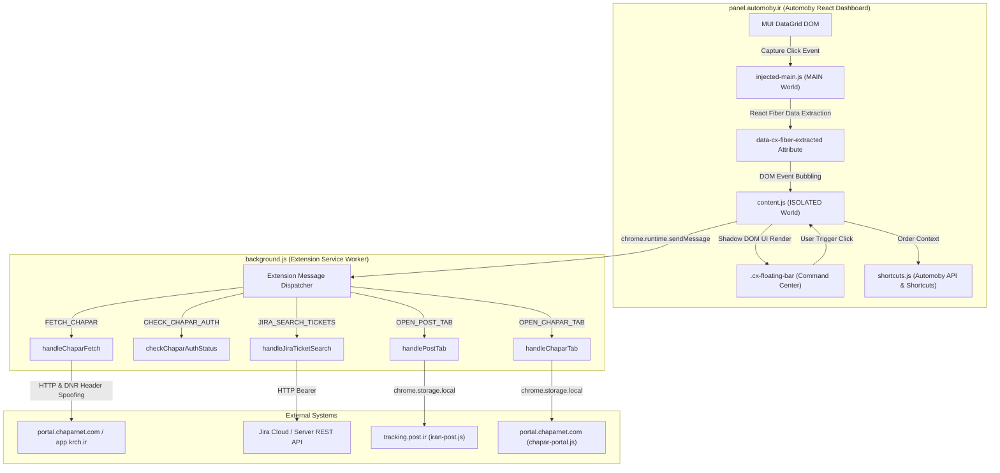

# Architecture and Critical Data Flows Map (v19.0)

This document provides the authoritative, code-verified architecture and data flow map for **Delivery Assistant (v19.0)**. Every path is traced directly from source code implementation.

---

## 1. High-Level System Architecture

Delivery Assistant is a Chrome Extension built on **Manifest V3** with three distinct runtime execution contexts:

---

## 2. Detailed Data Flows by Major Feature

### Feature 1: Automoby Row Selection & Multi-Tier Field Resolution
1. **User Action:** Operator clicks any row in the Automoby `MuiDataGrid` table (`.MuiDataGrid-row`).
2. **Capture Phase (`injected-main.js`):**
   - Captures event in `capture: true` before React synthetic handlers fire.
   - Calls `extractRowFromReact(row)`: traverses React Fiber (`__reactFiber$...`, `memoizedProps.row`, `memoizedProps.rowModel`, `memoizedProps.apiRef.current.getRow(id)`).
   - Resolves all raw fields via `extractFields(rowObj)`:
     - `phone`: Scans `PHONE_KEYS`, nested addresses (`addressClone.receiverPhoneNumber`, `order.user.phoneNumber`), and phone regex `/^(0098|0|\+98)?9\d{9}$/`.
     - `waybill`: Scans `WAYBILL_KEYS`, nested shipping objects, and barcode regex patterns.
     - `name`: Scans `NAME_KEYS`, `userFullName`, or address clone names.
     - `orderId`: Scans `ORDER_KEYS` or nested order IDs.
     - `parcelId`: Scans `explicitParcelKeys` or `rowObj.id` strictly on `/parcel/` routes.
   - Encodes fields as JSON into `row.setAttribute('data-cx-fiber-extracted', JSON.stringify(fields))`.
3. **Bubble Phase (`content.js`):**
   - Event bubbles to `content.js` row click listener.
   - Reads `getFiberExtractedData(row)` (Tier 1: Fiber).
   - If missing, calls `extractData(rowFragments, FIELDS)` on mounted DOM cells (Tier 2: DOM).
   - If missing and row has a valid `data-id`, checks `rowDataCache.get(rowId)` (Tier 3: Cache).
   - Sanitizes and normalizes:
     - Converts Persian/Arabic digits via `toAsciiDigits()`.
     - Rejects dummy notes (`حضوری`, `تحویل حضوری`, `پیک`, placeholders).
   - Updates `activeCustomerName`, `activeCustomerPhone`, `activeCustomerWaybill`.
   - Updates floating bar: customer name, `#cx-order-chip`, `#cx-phone-widget`, `#cx-waybill-widget`.
   - Calls `window.CX_SHORTCUTS.setOrderContext(...)` with monotonic sequence increment.

---

### Feature 2: Customer Phone Number Display & Chapar Phone Search
1. **Activation:**
   - If `phone` is valid (length >= 7 and numeric), button activates: `📱 موبایل: [phone]`.
   - If absent, deactivates: `📱 موبایل: ندارد`.
2. **Click Trigger:**
   - Operator clicks `📱 موبایل: [phone]`.
   - Backs up phone to clipboard.
   - Dispatches `chrome.runtime.sendMessage({ action: 'FETCH_CHAPAR', type: 'گیرنده', query: phone })`.
3. **Background Processing (`background.js`):**
   - Calls `checkChaparAuthStatus(false)`.
   - If `NEEDS_LOGIN`, halts immediately and returns `{ success: false, error: 'AUTH_REQUIRED' }`.
   - If `AUTHENTICATED`:
     - Queries `portal.chaparnet.com/OBJ/List/Consignment.php` with receiver phone search fields.
     - Parses response via `parseSloppyJSON()`.
     - Returns `{ success: true, isPhoneList: true, data: parsedResults }`.
4. **UI Presentation:**
   - `content.js` verifies monotonic `currentRoutingSeq`.
   - Calls `renderPhoneListModal(data)` in `ui-render.js` to render waybill cards.

---

### Feature 3: Smart Waybill Routing (Chapar vs. Iran Post)
1. **Routing Classifier (`isChaparWaybill(wb)`):**
   - If `/^\d{20,24}$/.test(wb)` and does NOT start with `5410`, `5480`, or `6410` → Route to **Iran Post**.
   - If `wb` starts with `5410`, `5480`, `6410`, `54`, or `64` → Route to **Chapar**.
   - Otherwise → Route to **Iran Post**.
2. **Iran Post Execution:**
   - Sends `{ action: 'OPEN_POST_TAB', query: waybill }`.
   - `background.js` sets `chrome.storage.local.set({ postTrackingTask: waybill })` and opens `https://tracking.post.ir/`.
   - `iran-post.js` injects into `tracking.post.ir`, polls for `#txtSearch`, fills value, triggers DOM events, and focuses Captcha.
3. **Chapar Execution:**
   - Sends `{ action: 'FETCH_CHAPAR', query: waybill }`.
   - `background.js` verifies pre-flight authentication.
   - Searches `Consignment.php` by waybill.
   - Fallback Step 2: Wildcard suffix (`%` + waybill.slice(3)).
   - Fallback Step 3: Receiver phone search (strictly filtered by waybill).
   - If internal consignment found: fetches consignment items, history logs, and xajax popup form.
   - If confirmed zero internal rows and authenticated: returns `{ isPublicOnly: true }` for public tracking modal.
   - Merges and caches final record for 45 seconds.
   - `ui-render.js` renders visual timeline modal (`renderTrackingModal`).

---

### Feature 4: Chapar Authentication & Session Detection Architecture
Chapar session state is evaluated through five distinct states:
- `UNKNOWN`: Insufficient evidence to determine session state.
- `CHECKING`: Verification request currently in-flight.
- `AUTHENTICATED`: Positive confirmation of active employee portal session (Flexigrid with rows, `P=Operation`, welcome tokens, xajax functions, logout link).
- `NEEDS_LOGIN`: Verified login page, password prompt without session, HTTP 401/403, or redirect to `P=Login`.
- `PORTAL_UNAVAILABLE`: Server 500/502/503 or network timeout.

**Key Rule:** Empty Flexigrid `{page:1,total:0,rows:[]}` on its own returns `UNKNOWN`, NEVER `AUTHENTICATED`.

---

### Feature 5: Jira Ticket Lookup & Read-Only Integration
1. Upon row selection with `parcelId` or `waybill`, `content.js` calls `updateJiraWidgetForSelectedRow`.
2. Dispatches `chrome.runtime.sendMessage({ action: 'JIRA_SEARCH_TICKETS', parcelId, waybill })`.
3. `background.js` queries Jira JQL (`summary ~ "parcelId" OR text ~ "waybill"`).
4. If Jira session expired, server returns HTML/redirect; `background.js` classifies as `AUTH_REQUIRED`.
5. `content.js` renders ticket badge or error state with unconditional login button (`ورود ↗`) and retry button (`🔄`).
6. Zero write actions are permitted; Jira integration is strictly read-only.

---

### Feature 6: Pending-Payment Filter (MUI DataGrid Model Layer)
1. **Scope:** Strictly active on `/parcel/` (Admin Orders).
2. **Activation:** Controlled by `data-cx-hide-pending="true"`.
3. **Data Model Layer Filtering:**
   - Handled in `injected-main.js` via `getGridFiber().apiRef.current.setRows(targetRows)`.
   - Completely avoids DOM `display: none !important` rules that collapse viewport and cause vertical layout gaps.
4. **Preservation Business Rule:**
   - All non-pending records (`SELLER_SHIPPED`, `DELIVERED`, `CANCELLED_ADMIN`) are always preserved.
   - For pending payment records (`PAYMENT_PENDING`, `در انتظار پرداخت`):
     - Associates candidates with the active search reference (searched phone number or order ID).
     - Preserves **one eligible pending record** for the active reference so the operator can inspect pending checkout attempts.
     - Hides remaining redundant duplicate pending records.

---

### Feature 7: Extension Settings & Local Persistence
- Settings (`cxAlways100`, `cxHidePendingPayment`, `cxEnabledShortcuts`) are stored in `chrome.storage.local`.
- Synchronized to DOM attributes on `document.documentElement` (`data-cx-always-100`, `data-cx-hide-pending`).
- Handled via `chrome.storage.onChanged` listeners across tabs without page reload.

---

### Feature 8: Sequence Guards & Race Condition Protection
- `currentRoutingSeq`: Incremented on each new row click and route transition. Prevents slow Chapar/Post lookups from overwriting newer selections.
- `currentJiraSeq`: Monotonic counter for Jira ticket lookups.
- `currentContext.seq`: Monotonic counter in `shortcuts.js` for background GraphQL checks.
- If response arrives and `thisSeq !== activeSeq`, response is discarded immediately.
