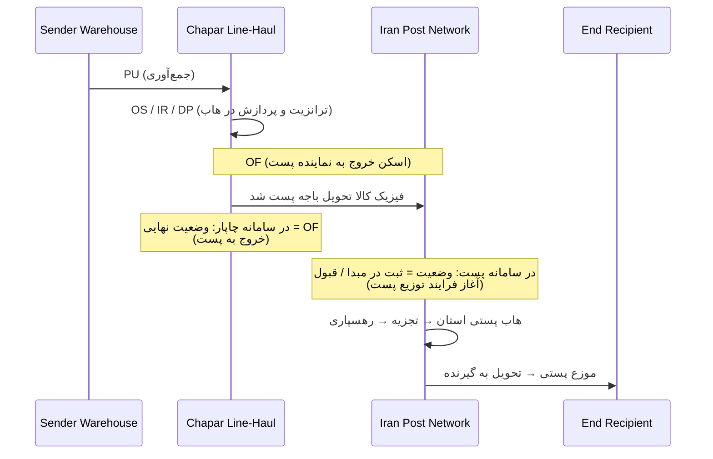

# Chapar Logistics Status Taxonomy & Operational Semantics

> **Document Version:** 2.0 (Production Audit Edition)  
> **Target Systems:** Chapar Portal (`portal.chaparnet.com`), Chapar Tracking API (`cdn.chaparnet.com`), Iran Post (`tracking.post.ir`)  
> **Security Classification:** Strict Read-Only / Zero Business Mutation / No Credentials Stored  
> **Empirical Scope:** Multi-page audit across 1,600 production consignments (Flexigrid RPC `rp=200`, pages 1–8)  

---

## 1. Executive Summary & Philosophy: "Status Colors are Data"

In the Chapar operational ecosystem, visual presentation is not arbitrary decoration; it directly conveys real-time logistics risk and delivery progress. However, **the Chrome extension never infers status from screen pixels or computed CSS color alone**.

Instead, the Extension implements a **Data-Driven Semantic Status Architecture**:
```text
Raw Chapar Event (Code / Raw Persian Text / API Payload)
         ↓
Centralized Normalizer & Parser (`resolveChaparStatus`)
         ↓
Semantic Status & Operational Category (Delivered, Transit, Delayed, Refused, Returned, Postal)
         ↓
Presentation Metadata (Verified Hex, High-Contrast Badge, ARIA Labels, Severity, Icon)
         ↓
Delivery Assistant UI (Floating Bar, Tracking Modal, Phone List Cards, Timelines)
```

This guarantees:
1. **Semantic Fidelity:** A status like `"عدم تحویل بدلیل آدرس یا تلفن اشتباه"` is never mistakenly flagged as delivered simply because the Persian word `"تحویل"` appears in the text.
2. **Accessible by Design:** Color is never the sole carrier of meaning. Every state features explicit textual labels, Unicode visual iconography (`✅`, `⚠️`, `🛑`, `🛵`, `🚚`, `📮`), and W3C WAI-ARIA `role="status"` announcements.
3. **Multi-Carrier Independence:** Chapar's internal handoff state (`OF` - Outbound to Postal Agent) is cleanly distinguished from Iran Post's actual domestic distribution milestones.

---

## 2. Empirical Methodology & Discovery

An exhaustive, read-only empirical survey was conducted across 1,600 live consignments using Chapar Portal's internal RPC endpoint:
- **Endpoint:** `POST https://portal.chaparnet.com/OBJ/List/Consignment.php?Filter=&__Method=Internal&`
- **Parameters:** `rp=200`, `sortname=tbl_cons.fld_Cons_No`, `sortorder=DESC`, pages 1 to 8.
- **Detailed History Endpoint:** `POST https://portal.chaparnet.com/OBJ/List/ConsignmentHistory.php?cons_no=<INTERNAL_ID>&__Method=Internal&`
- **DOM Inspection Target:** `FormConsignmentHistoryTable` (`Tab1`).

### Live DOM & Color Generation Mechanisms Discovered:
1. **Delivered State (`OK`):**
   - Renders a prominent green banner at the top of `Tab1`:  
     `<span style="color:green;font-size:20px;font-weight: bold;">&nbsp;<ReceiverName>: <HH:mm> <YYYY/MM/DD></span>`
   - Image asset: `Images/SmallTickGreen.png` (explicit green checkmark).
2. **Delivery Deadline Alerts:**
   - Overdue shipments display a flashing red warning:  
     `حداکثر زمان تحویل: <span style="color:red" class="blink"><YYYY/MM/DD> <HH:mm></span>`
3. **Unscanned / Missing Items:**
   - Packages not yet accounted for at hub manifest in red text:  
     `<div style="width:100%;font-size:15px;color:red">بارنامه های اسکن نشده: ...</div>`
4. **Column Discrepancy:**
   - The consignment overview grid emits short acronym codes (`OK`, `DAR`, `CR`, `RO`, `OF`, `OS`, `NH`, `WA`, `TW`, `CI`, `DP`, etc.) in `cell[6]`.
   - The detailed history grid emits fully qualified Persian event phrases (`سالم تحویل شد`, `امتناع گیرنده از دریافت`, `نبود گیرنده`) in `cell[2]`.
   - Public API (`cdn.chaparnet.com`) prefixes code with text: `status: "NH (نبود گیرنده)"`.

---

## 3. Discovered Status Taxonomy Table

The audit identified **19 distinct operational status states** in the Chapar logistics engine:

| Status Code | Exact Visible Persian Text | Semantic Category | Operational Meaning | Visual Indicator / Color | Severity | Terminal? | Verified Waybill Example |
| :---: | :--- | :--- | :--- | :--- | :---: | :---: | :---: |
| **`OK`** | `سالم تحویل شد` / `تحویل شد` | `DELIVERED` | Consignment successfully delivered to recipient | Green (`#10b981`), `SmallTickGreen.png`, `✅` | `SUCCESS` | **Yes** | `54807199275779101` |
| **`OD`** | `توزیع توسط پیک` / `توزیع توسط نماینده` | `OUT_FOR_DELIVERY` | Out for delivery with local courier | Cyan (`#06b6d4`), `🛵` | `INFO` | No | `54101713507302101` |
| **`NH`** | `نبود گیرنده` / `عدم حضور گیرنده در محل` | `DELIVERY_PROBLEM` | Recipient unavailable/not home at delivery attempt | Amber (`#f59e0b`), `⚠️` | `WARNING` | No | `54807199290193101` |
| **`WA`** | `عدم تحویل بدلیل آدرس یا تلفن اشتباه` | `DELIVERY_PROBLEM` | Address incorrect, incomplete, or phone unreachable | Amber (`#f59e0b`), `⚠️` | `WARNING` | No | `54807199290428101` |
| **`DAR`** | `تاخیر در توزیع` / `در حال بررسی جهت توزیع` | `DELIVERY_PROBLEM` | Delayed in delivery, under operational review | Amber (`#f59e0b`), `⏳` | `WARNING` | No | `54807199278859101` |
| **`OC`** | `ظرفیت تکمیل شد` | `DELIVERY_PROBLEM` | Courier capacity full; dispatch hold | Amber (`#f59e0b`), `⚠️` | `WARNING` | No | Page 3 Sample |
| **`TW`** | `ارسال به انبار موقت` | `HOLD` | Held in temporary hub warehouse | Amber (`#f59e0b`), `📦` | `WARNING` | No | Page 4 Sample |
| **`CR`** | `امتناع گیرنده از دریافت` | `REJECTED` | Recipient explicitly refused to accept shipment | Red (`#ef4444`), `🛑` | `DANGER` | No | `54807199286116101` |
| **`RO`** | `عودت به مشتری(نهایی)` | `RETURNED` | Package permanently returned to original sender | Red (`#ef4444`), `↩️` | `DANGER` | **Yes** | `54807199285115101` |
| **`RH`** | `عودت به پیمانکار فرستنده` | `RETURNING` | Package in return transit to sender's contractor | Red (`#ef4444`), `↩️` | `DANGER` | No | Page 6 Sample |
| **`RCH`** | `برگشت به سوله مرکزی` | `RETURNING` | Consignment returned to Chapar Central Hub | Red (`#ef4444`), `↩️` | `DANGER` | No | `54807199289917101` |
| **`OF`** | `اسکن خروج به نماینده پست` | `POSTAL_HANDOFF` | Handed over to Iran Post agent for final mile | Purple (`#8b5cf6`), `📮` | `SPECIAL` | Conditional | `54807199275172101` |
| **`OS`** | `حرکت از مبدا` / `اسکن خروج از هاب` | `IN_TRANSIT` | Dispatched from hub / line-haul transit | Blue (`#3b82f6`), `🚚` | `INFO` | No | `54807199275172101` |
| **`IR`** | `اسکن ورود` | `IN_TRANSIT` | Arrived at destination/transit sorting hub | Blue (`#3b82f6`), `📥` | `INFO` | No | `54807199275172101` |
| **`CI`** | `تخلیه بار` | `IN_TRANSIT` | Cargo unloaded at distribution center | Blue (`#3b82f6`), `🚚` | `INFO` | No | Page 2 Sample |
| **`DP`** | `پردازش پاکات` | `PROCESSING` | Automated letter/parcel sorting at hub | Blue (`#3b82f6`), `⚙️` | `INFO` | No | Page 5 Sample |
| **`PU`** | `جمع آوری بار` | `PICKED_UP` | Parcel physically picked up from client warehouse | Slate (`#6b7280`), `📦` | `NEUTRAL` | No | `54807199275779101` |
| **`PDR`** | `مستندات جمع آوری رسید` | `PICKED_UP` | Pickup manifests signed and acknowledged | Slate (`#6b7280`), `📋` | `NEUTRAL` | No | Page 1 Sample |
| **`D01`** | `ورود اطلاعات` | `REGISTERED` | Consignment registered / manifest draft created | Slate (`#6b7280`), `📝` | `NEUTRAL` | No | `54807199290193101` |

---

## 4. Color Semantics & Psychological Meaning in Chapar

Chapar’s color palette aligns with standard international transportation safety conventions:

1. **Green (`#10b981` / `rgb(16, 185, 129)`): Terminal Operational Success**
   - Exclusively represents **verified physical delivery** to the customer or recipient.
   - Associated with `Images/SmallTickGreen.png` and `سالم تحویل شد`.
   - Never used for in-transit or handover states.
2. **Red (`#ef4444` / `rgb(239, 68, 68)`): Operational Failure, Return, Rejection & Overdue**
   - Signifies severe delivery breakdown: customer refusal (`CR`), returned to sender (`RO`), or overdue SLA deadlines (`class="blink"`).
   - Requires immediate call-center awareness.
3. **Amber (`#f59e0b` / `rgb(245, 158, 11)`): Operational Delay / Customer Contact Required**
   - Represents non-fatal delivery obstacles: recipient was absent (`NH`), incorrect phone/address (`WA`), or capacity overflow (`OC`).
   - Requires operator outreach to reschedule or verify recipient details.
4. **Cyan (`#06b6d4` / `rgb(6, 182, 212)`): Active Distribution (Out for Delivery)**
   - Package is currently in the courier's vehicle (`OD`) for same-day delivery.
5. **Purple (`#8b5cf6` / `rgb(139, 92, 246)`): Multi-Carrier Postal Handoff**
   - Transferred to the postal distribution network (`OF`).
6. **Blue (`#3b82f6` / `rgb(59, 130, 246)`): Standard Line-Haul Hub Transit**
   - Normal warehouse sorting, scanning, loading, and city-to-city transport (`OS`, `IR`, `CI`, `DP`).
7. **Slate / Neutral (`#6b7280` / `rgb(107, 114, 128)`): Origin & Registration**
   - Initial administrative registration, pickup acknowledgement, and docket creation (`D01`, `PU`, `PDR`).

---

## 5. Iran Post Interaction & Multi-Carrier Stage Semantics

A critical operational challenge occurs when shipments transition between Chapar and Iran Post:



### Key Principles for Call-Center Operators:
1. **Chapar Status ≠ Post Status:**
   - In Chapar, an event like `OF` (اسکن خروج به نماینده پست) represents Chapar’s final responsibility milestone.
   - In Post, the shipment is just entering domestic postal distribution.
   - **Rule:** The extension **never overwrites** Chapar’s history with Post’s history. Instead, it surfaces both:
     - Prominent Postal Handoff Banner with 24-digit barcode.
     - Direct one-click `"📦 پیگیری در سامانه پست"` button.
     - Clear clarifying caption:  
       *«وضعیت در چاپار نشان‌دهنده تحویل بسته به پست است. جهت پیگیری روند توزیع نهایی تا مقصد، از سامانه رهگیری پست استفاده کنید.»*
2. **Barcode Resolution:**
   - If Chapar's `third_reference` or any package identifier (`packageIds`) contains 20–24 digits, it is classified as `POSTAL_HANDOFF`.
   - If marked as postal (`method === '11'` or service containing `'پستی'`) but lacks a 24-digit barcode, it is classified as `POSTAL_PENDING` (*«در انتظار صدور بارکد پستی»*).

### 5.3. Chapar PACKAGE_LIST / manifest_item & «کد رهگیری احتمالی»

1. **Source of this Value:**
   - Emitted inside the deepest authenticated Chapar consignment history popup (`FormConsignmentHistory`), fetched via xajax from `portal.chaparnet.com/index.php?P=Operation&Tab=Consignment`.
   - Structural container: `<div id="PACKAGE_LIST">`.
   - Item element: `<div class="manifest_item">`.

2. **Field Meaning & Operational Semantics:**
   - This identifier represents a package/manifest item identifier exposed in Chapar's internal database.
   - **Crucial Rule:** It is **NOT** automatically classified as an official postal tracking number.
   - It does **NOT** alter the shipment classification engine (`classifyShipment`).
   - It does **NOT** trigger automatic routing to Iran Post (`tracking.post.ir`).

3. **Exact User-Facing Label:**
   - **`کد رهگیری احتمالی`**
   - The UI displays:
     ```text
     کد رهگیری احتمالی: <IDENTIFIER>
     ```
   - Labels such as *Package ID*, *Package List*, *Postal Tracking Number*, or *کد رهگیری پست* are explicitly forbidden for this field.

4. **Rationale for the Neutral Label:**
   - The label `"کد رهگیری احتمالی"` was intentionally chosen because while this manifest identifier frequently correlates with downstream external tracking numbers, it may or may not ultimately correspond to a valid, activated external courier barcode. Surfacing it neutrally gives the operator full operational awareness without making false system assumptions.

5. **Discovery Reference DOM Structure:**
   ```html
   <div id="PACKAGE_LIST"
        style="width:300px;height:165px;padding:2px;font-weight:bold;float:left;font-size:30px;line-height:30px;border:1px solid black;overflow:scroll">
       <div id="<IDENTIFIER>"
            class="manifest_item"
            style="cursor:pointer;">
           <IDENTIFIER>
       </div>
   </div>
   ```

6. **End-to-End Data Flow:**
   ```text
   Chapar detail (FormConsignmentHistory popup)
            ↓
   PACKAGE_LIST / manifest_item
            ↓
   extractChaparManifestItems() in background.js
            ↓
   internal data model (manifestItems, probableTrackingNumber)
            ↓
   extension details UI (renderTrackingModal -> "کد رهگیری احتمالی")
   ```

---

## 6. Accessibility & W3C Standards Compliance

In accordance with WCAG 2.1 Level AA:
- **Contrast Ratios:** All status badges maintain a minimum contrast ratio of `4.5:1` against their respective backgrounds in both Light Mode and Dark Mode.
- **Color Independence:** Color is accompanied by:
  1. Explicit Persian status wording.
  2. Distinct Unicode symbols (`✅`, `⚠️`, `🛑`, `🛵`, `🚚`, `📮`, `📦`, `📝`).
  3. Screen-reader accessible markup:
     ```html
     <span class="cx-status-badge badge-danger" role="status" aria-label="وضعیت: امتناع گیرنده از تحویل بسته (مرجوعی)">
         🛑 امتناع گیرنده از دریافت
     </span>
     ```
- **Live Regions:** Status banners utilize `role="status"` and `role="region"` for non-disruptive assistive technology announcements.

---

## 7. Implementation Artifacts Reference

- **Centralized Status Normalizer:** `resolveChaparStatus(statusInput)` in [`ui-render.js`](file:///c:/Users/mrmki/Documents/antiGG%20repo/Delivery%20Assistant/ui-render.js).
- **Styles & Dark Mode Overrides:** [`styles.css`](file:///c:/Users/mrmki/Documents/antiGG%20repo/Delivery%20Assistant/styles.css) (`.badge-success`, `.badge-warning`, `.badge-danger`, `.badge-cyan`, `.badge-primary`, `.badge-purple`, `.badge-neutral`).
- **Classification Engine:** `classifyShipment` and `deriveDeliveryDate` in [`background.js`](file:///c:/Users/mrmki/Documents/antiGG%20repo/Delivery%20Assistant/background.js).
- **Data Flow & Navigation:** [`docs/SPIDER_MODEL.md`](file:///c:/Users/mrmki/Documents/antiGG%20repo/Delivery%20Assistant/docs/SPIDER_MODEL.md).
