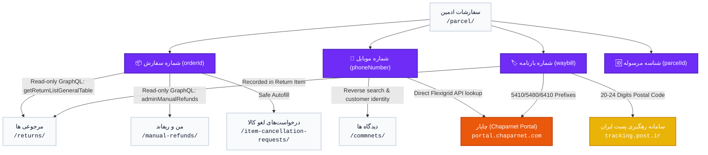

# Automoby Spider Model & Context-Aware Shortcut Architecture

> **Document Version:** 1.0  
> **Scope:** `panel.automoby.ir` Integration Engine — Delivery Assistant Extension  
> **Security Classification:** Strict Read-Only / Production Protected  

---

## 1. Executive Overview & "Spider-Web" Philosophy

In call-center operations, an operator rarely views an entity in isolation. A single customer contact involves multiple interrelated facets of a transaction:
- The **Order Number** links parcels, items, cancellations, returns, and financial refunds.
- The **Phone Number** links customer identities, historic orders, and external courier shipments (Chapar).
- The **Waybill / Barcode** links physical logistics tracking across Chapar and Iran Post.

Previously, operators had to manually copy identifiers, open multiple tabs, navigate through dense menus, paste values into various search fields, and wait for results. 

The **Spider Model** transforms the Delivery Assistant extension into a unified, context-aware navigational nexus:
1. **Shared Context:** Selecting any row in the panel extracts a complete identifier tuple (`orderId`, `parcelId`, `phone`, `waybill`, `name`).
2. **Background Status Badges:** Without leaving the current view, the extension asynchronously queries relevant sections (e.g., Returns, Refunds) using read-only GraphQL APIs and displays live status chips (e.g., `مرجوعی: ۱ فعال`, `فاقد ریفاند`).
3. **One-Click In-Tab Navigation:** Clicking a shortcut navigates directly to that section in the current browser tab and automatically fills and triggers the search filter.
4. **Zero Destructive Actions:** All automated behaviors are strictly limited to DOM reads, search input population, and in-place SPA navigation. No business mutating actions are ever performed.
5. **Unified Logistics Taxonomy:** Deep semantic alignment across Chapar, Post, and Automoby states. See [CHAPAR_STATUS_TAXONOMY.md](file:///c:/Users/mrmki/Documents/antiGG%20repo/Delivery%20Assistant/docs/CHAPAR_STATUS_TAXONOMY.md) for full operational breakdown.

---

## 2. Spider Web Data Relationship Map



---

## 3. Discovered Panel Routes & Navigation Mechanisms

The Automoby panel is a single-page React application using React Router v6. Sidebar navigation items are wrapped in Material-UI `Button` / `ListItem` components managed by an internal routing handler.

### Key Navigation Insight:
Clicking the outer `<button>` does not trigger navigation directly; the synthetic `onClick` handler (calling React Router's `useNavigate()`) is attached to the inner `<li class="MuiListItem-root">` element.

The extension implements `navigateInPanel(targetRoute)`:
1. Inspects the current `window.location.pathname`. If already matching the destination, navigation is skipped.
2. Traverses sidebar buttons and checks React Fiber memoized props (`fiber.memoizedProps.item.path`).
3. Dispatches a `.click()` event to the inner `<li>` element.
4. Performs in-place SPA navigation without reloading the window or spawning redundant browser tabs.

### Discovered Route Directory:
| Section Title | Route Path | Group | Supported Identifiers | Primary Search Field |
| :--- | :--- | :--- | :--- | :--- |
| **سفارشات ادمین** | `/parcel/*` | Admin | `orderId`, `phone`, `waybill` | `label: "جست و جو ..."` (`#\:rq1\:`) |
| **مرجوعی ها** | `/returns/*` | Support | `orderId`, `waybill` | `placeholder: "شماره سفارش"` |
| **من و ریفاند** | `/manual-refunds/*` | Support | `orderId`, `userId` | `label: "شماره سفارش"` (`#\:rmt\:`) |
| **درخواست‌های لغو کالا** | `/item-cancellation-requests/*` | Support | `orderId` | Search textfield |
| **استعلام** | `/inquiry/*` | Admin | `orderId` | Search input |
| **دیدگاه ها** | `/commnets/` | Support | `phone`, `carPartId` | Comment filter |
| **محصول** | `/product/*` | Commerce | `carPartId` | Product code search |
| **تسویه** | `/settlement/` | Finance | `supplierId` | Settlement filter |

---

## 4. Technical Deep Dive: Primary Destination Shortcuts

### 4.1. مرجوعی ها (Returns — `/returns/`)
* **Role:** Customer item returns tracking and return package verification.
* **Identifier:** `orderId` (Integer).
* **GraphQL Query (Status Inspection):**
  ```graphql
  query getReturnListGeneralTable($query: ReturnItemListInput!) {
    getReturnListGeneralTable(query: $query) {
      total
      count
      data {
        id
        returnId
        state
        refundState
        customerReason
        return {
          id
          billOfLading
          courier
        }
      }
    }
  }
  ```
* **Variables:** `{ query: { orderId: <INT>, pagination: { page: 0, limit: 5 } } }`
* **Status Mapping:**
  - `total > 0`: Active return exists (`badge-active`, text: `<count> مرجوعی`).
  - `total === 0`: No active return (`badge-none`, text: `فاقد مرجوعی`).
* **Safe Autofill:** Locates `input[placeholder="شماره سفارش"]`, sets value via property descriptor, and dispatches native `input` + `change` events.

---

### 4.2. من و ریفاند (Manual Refunds — `/manual-refunds/`)
* **Role:** Tracking manual and automated bank refund operations to customer accounts.
* **Identifier:** `orderId` (Integer).
* **GraphQL Query (Status Inspection):**
  ```graphql
  query adminManualRefunds($page: Int!, $limit: Int!, $orderId: Int) {
    adminManualRefunds(page: $page, limit: $limit, orderId: $orderId) {
      total
      items {
        id
        orderId
        amount
        state
        paymentGateway
        userFullName
        userCurrentSheba
      }
    }
  }
  ```
* **Variables:** `{ page: 1, limit: 5, orderId: <INT> }`
* **Status Mapping:**
  - `total > 0`: Active refund record exists (`badge-active`, text: `<count> ریفاند`).
  - `total === 0`: No refund record (`badge-none`, text: `فاقد ریفاند`).
* **Safe Autofill:** Locates `label: "شماره سفارش"` input, applies value, and dispatches events.
* **CRITICAL SAFETY NOTE:** This view contains financial transaction buttons (e.g., `ثبت بازپرداخت`, `ایجاد استرداد دستی`). The extension code strictly prohibits clicking any interactive element on this page other than entering text into the filter search input.

---

### 4.3. سفارشات ادمین (Admin Orders — `/parcel/`)
* **Role:** Core operating table for consignment parcel lifecycle.
* **Identifiers:** `orderId`, `customerMobile`, `waybill`.
* **GraphQL Query:** `adminParcelsGet` (uses `$fullTextSearch` parameter).
* **Safe Autofill:** Locates `label: "جست و جو ..."` (`#\:rq1\:`), sets value, and filters the live DataGrid.

---

## 5. Reusable Shortcut & Context Architecture

The architecture is implemented in `shortcuts.js` and decoupled from the presentation and DOM layers.

### 5.1. Context State & Stale Response Invalidation
To prevent race conditions when an operator quickly switches between rows (Order A $\rightarrow$ Order B):
```javascript
let currentContext = {
    seq: 0,
    orderId: '',
    parcelId: '',
    phone: '',
    waybill: '',
    name: ''
};
```
Every selection increments `seq`. When asynchronous GraphQL queries return, if `thisSeq !== currentContext.seq`, the response is immediately dropped. This ensures Order B never inherits stale badges from Order A.

### 5.2. Safe Input Autofill Mechanism
React 18 overrides native input value setters with custom tracking wrappers. Direct assignment (`input.value = x`) is ignored by React's internal state. The extension uses the native prototype setter:
```javascript
const setter = Object.getOwnPropertyDescriptor(window.HTMLInputElement.prototype, 'value')?.set;
setter.call(input, value);
input.dispatchEvent(new Event('input', { bubbles: true }));
input.dispatchEvent(new Event('change', { bubbles: true }));
```

### 5.3. User Configuration & Persistence
User preferences for enabled shortcuts are stored in `chrome.storage.local` under the key `cxEnabledShortcuts`:
- Default: `['returns', 'manual_refunds', 'admin_orders']`
- Configurable via the `⚙️` modal in the floating bar.
- Changes apply dynamically across sessions without requiring extension reinstalls.

---

## 6. Security Boundaries & Production Safety Rules

| Category | Allowed Actions | STRICTLY PROHIBITED Actions |
| :--- | :--- | :--- |
| **DOM Interactions** | Row click reading, focus, search input value assignment, sidebar navigation clicks | Clicking submit buttons, confirm modals, delete icons, edit toggles |
| **Network Requests** | Read-only GraphQL queries (`query adminManualRefunds`, `query getReturnListGeneralTable`) | Any GraphQL `mutation`, POST form submissions, PATCH/DELETE HTTP requests |
| **Financial Views** | Filtering by `orderId` | Clicking `ثبت بازپرداخت`, `ایجاد استرداد دستی`, `نیازمند اصلاح شبا` |
| **Order Status** | Reading status tags | Clicking status dropdowns, cancel buttons, packing confirmation |

---

## 7. Extending the System (Adding New Shortcuts)

To add another section to the shortcut engine in the future:
1. Open [shortcuts.js](file:///c:/Users/mrmki/Documents/antiGG%20repo/Delivery%20Assistant/shortcuts.js).
2. Append a new definition object to `SHORTCUT_REGISTRY`:
   ```javascript
   {
       id: 'unique_id',
       title: 'عنوان بخش',
       icon: '📌',
       route: '/target-route/',
       defaultEnabled: false,
       supportedKeys: ['orderId', 'phone'],
       description: 'توضیحات کوتاه برای کاربر',
       checkStatus: async (context, token) => {
           // Optional: read-only GraphQL or API check
       },
       fillSearch: (context) => {
           // Locate search input and call safeFillInput(input, context.key)
       }
   }
   ```
3. The new shortcut automatically appears in the `⚙️ تنظیمات میانبرها` modal and can be enabled by the operator.
